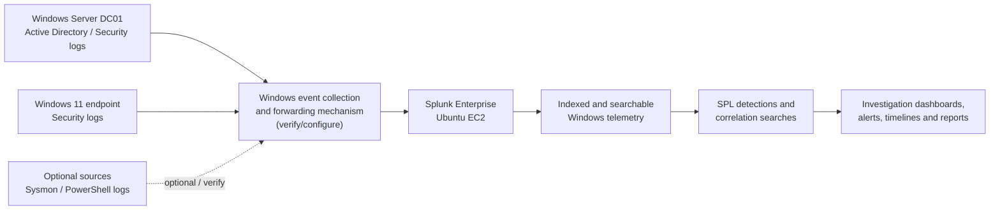

# Enterprise Active Directory Threat Detection and Investigation with Splunk

A blue-team security engineering lab for collecting and validating Windows/Active Directory telemetry, building SPL detections, correlating identity and endpoint activity, and documenting investigations with evidence.

> **Project type:** Controlled lab and portfolio project  
> **Current status:** In progress — validate each component before marking it verified  
> **Environment:** Splunk Enterprise on Ubuntu EC2, Windows Server domain controller (`DC01`), Windows 11 domain-connected endpoint, Active Directory domain `corp.local`, AWS VPC `10.0.0.0/16`

This repository is intended to demonstrate a repeatable detection-engineering workflow, not to represent a production deployment. A capability is **Verified** only after its configuration and supporting evidence have been inspected.

## Contents

- [Project goals](#project-goals)
- [Status and scope](#status-and-scope)
- [Architecture](#architecture)
- [Lab inventory and prerequisites](#lab-inventory-and-prerequisites)
- [Initial setup and deployment](#initial-setup-and-deployment)
- [Telemetry and data model](#telemetry-and-data-model)
- [Detection engineering catalogue](#detection-engineering-catalogue)
- [Correlation and investigation methodology](#correlation-and-investigation-methodology)
- [Threat simulation and validation](#threat-simulation-and-validation)
- [Dashboards and reporting](#dashboards-and-reporting)
- [Evidence and screenshots](#evidence-and-screenshots)
- [Repository structure](#repository-structure)
- [Results and evaluation](#results-and-evaluation)
- [Security and ethical considerations](#security-and-ethical-considerations)
- [Limitations and future improvements](#limitations-and-future-improvements)
- [Conclusion](#conclusion)

## Project goals

Active Directory (AD) is a central identity and access-management service in many Windows environments. Authentication failures, privileged logons, group membership changes, Kerberos activity, remote access, and process execution can provide important evidence during a security investigation. Without suitable auditing, collection, and retention, however, a SIEM may have only a partial view of these activities.

This project uses Splunk Enterprise to develop and evaluate a practical monitoring workflow for a controlled AD lab. It focuses on validating the data before writing detections, explaining the logic behind each search, correlating related events, and recording both successful and unsuccessful tests.

### Objectives

1. Verify the Windows telemetry that is actually available in Splunk.
2. Identify indexes, hosts, sources, sourcetypes, event IDs, and extracted fields from observed data.
3. Build SPL searches for authentication, privilege changes, PowerShell, Kerberos, remote logons, services, and process execution.
4. Correlate events across users, hosts, source addresses, and time windows.
5. Validate searches using authorized activity in the lab and retain evidence of the observed results.
6. Investigate alerts using a repeatable evidence-based workflow.
7. Document limitations, false-positive considerations, and follow-up engineering work.

### Skills demonstrated

- Splunk Search Processing Language (SPL)
- Windows Security event analysis and auditing
- Active Directory identity and privilege monitoring
- Detection engineering and correlation
- Threat hunting and incident triage
- Event-field discovery and data-quality assessment
- MITRE ATT&CK mapping
- PowerShell and Linux administration
- AWS lab security, Git, GitHub, and technical documentation

### Why AD telemetry matters to a SOC

A single event rarely proves malicious activity. A failed logon may be a mistyped password; a privileged logon may be legitimate administration; a PowerShell process may be routine automation. Correlating activity over time and across relevant hosts can help an analyst distinguish routine behavior from activity that deserves investigation. Detection quality depends on both the search logic and the completeness and accuracy of the telemetry.

## Status and scope

Status definitions used in this repository:

| Status | Meaning |
|---|---|
| Planned | Designed but not yet implemented |
| In progress | Work is underway; completion has not been demonstrated |
| Implemented — pending validation | Configuration or search exists, but its behavior has not yet been demonstrated with evidence |
| Verified | The component was tested and the repository contains evidence supporting the claim |
| Blocked | A dependency or lab issue prevents validation |

Initial status is deliberately conservative:

| Capability | Initial status | Evidence needed to advance status |
|---|---|---|
| Splunk Enterprise on Ubuntu EC2 | Reported present; verify health | Splunk service/version check and successful Search & Reporting access |
| AD domain and DC01 | Lab exists; verify current state | Domain/DNS checks and sanitized configuration evidence |
| Windows 11 domain endpoint | Reported in scope; verify membership | Domain membership and hostname evidence |
| Windows events indexed in Splunk | Reported; details unverified | Search results showing index, host, source, sourcetype, and raw events |
| Event ID coverage | In progress | Observed examples for each event ID being used |
| SPL detections | Planned / in progress | Saved search, test procedure, observed result, and evidence |
| Correlation searches | Planned | Correlated events from a verified time window |
| Dashboard | Planned | Screenshot and saved dashboard definition |
| Test results and false-positive analysis | Pending validation | Completed test records and analyst notes |

Do not change a status to **Verified** merely because a configuration command completed. Verify the resulting telemetry or behavior.

## Project overview

| Capability | Purpose | Implementation status |
|---|---|---|
| Windows event analysis | Search collected Windows events and inspect raw evidence | Reported indexed; validate coverage |
| Authentication monitoring | Identify patterns in successful and failed logons | Planned / in progress |
| Privilege-change monitoring | Review changes to security-sensitive groups | Planned |
| Process and PowerShell monitoring | Investigate suspicious execution when the necessary logs exist | Planned; source coverage must be verified |
| Event correlation | Connect related activity across identities, hosts, and time | Planned |
| Threat hunting | Search for patterns that may not have triggered an alert | Planned |
| Investigation reporting | Record timeline, scope, impact, confidence, and evidence | Planned |
| Dashboards and alerting | Present trends and investigation queues | Planned |

## Architecture

The diagram shows the intended flow. The exact Windows collection and forwarding mechanism must be discovered or configured; it is not assumed to be Universal Forwarder, Windows Event Forwarding, an add-on, or another specific product.




*Figure 1 — Placeholder: add a rendered architecture diagram that matches the actual lab. Confirm the collection path before documenting it as implemented.*

### Component responsibilities

- **DC01:** Domain controller and source of relevant Windows Security and directory-service events, depending on audit policy and collection configuration.
- **Windows 11 endpoint:** Provides endpoint-side authentication and process evidence when the corresponding event channels and collection are configured.
- **Collection/forwarding layer:** Transports selected event channels to Splunk. Document the actual mechanism, configuration, and failure behavior after verification.
- **Splunk Enterprise:** Receives and indexes data, makes events searchable, and runs SPL searches and dashboards.
- **Detections and correlation searches:** Convert observed telemetry into testable hypotheses. Searches should include documented assumptions, expected fields, time windows, and known limitations.
- **Dashboards and reports:** Present validated results and support analyst investigation. A dashboard is not evidence that a detection is accurate by itself.

### Security considerations

Restrict Splunk Web and management access to trusted addresses or private access paths. Limit inbound AWS security-group rules to the minimum required. Use least-privilege accounts, protect administrative interfaces, keep systems patched, and avoid storing credentials in scripts or Git. The collection path should be protected against unauthorized access and monitored for ingestion failures.

## Lab inventory and prerequisites

### Prerequisites

| Component | Purpose | Verification method |
|---|---|---|
| AWS account and EC2 access | Hosts the Splunk server and any cloud-based lab systems | Confirm access to the intended instances and VPC |
| Ubuntu EC2 instance | Runs Splunk Enterprise | Confirm OS, service state, version, storage, and resource health |
| Splunk Enterprise | Indexes and searches telemetry | Sign in to Splunk Web and open Search & Reporting |
| Windows Server DC01 | Provides AD and Windows event sources | Verify hostname, domain, DNS, and event logging |
| Windows 11 endpoint | Provides endpoint-side events | Verify hostname, domain membership, and event channels |
| Network and DNS connectivity | Allows systems to resolve and reach required services | Check routes, DNS, and only the required ports |
| Appropriate permissions | Allows log inspection and authorized configuration | Confirm access without sharing passwords or tokens |
| Git and GitHub | Version-control searches, tests, docs, and sanitized evidence | Run `git --version`; confirm repository access |

### Lab inventory

Fill in the actual values after checking each machine. Do not publish public IP addresses, AWS account IDs, credentials, VPN configuration, or other sensitive details.

| Hostname | Operating system | Role | Private IP | Status |
|---|---|---|---|---|
| `SPLUNK-SERVER` (replace with actual hostname) | Ubuntu (version pending verification) | Splunk Enterprise | `<verify privately>` | Verify |
| `DC01` | Windows Server (version pending verification) | AD domain controller | `<verify privately>` | Reported present; verify |
| `<WINDOWS-ENDPOINT>` | Windows 11 (build pending verification) | Domain-connected endpoint | `<verify privately>` | Verify |

### Network and access notes

The lab uses an AWS VPC with CIDR `10.0.0.0/16`. This does not identify the private address of any individual host; record individual addresses only after verifying them in the AWS console or on the relevant host.

For each required path, document the source, destination, protocol/port, reason, and restriction. Do not open broad inbound access merely to make a connection work. Prefer private connectivity, VPN or a controlled administrative source where available. Do not expose Splunk Web to the public internet without a deliberate, secured access design.

## Initial setup and deployment

Perform these checks in order. Commands are examples; adapt them to the operating system, installation path, privileges, and collection method actually used.

### Step 1 — Prepare the AWS environment

1. Confirm that the intended EC2 instances are running and that you can administer them through the approved access method.
2. Verify the VPC and subnet associated with each instance.
3. Review security groups and network ACLs for the required paths only.
4. Confirm DNS resolution between systems where required. AD clients must use DNS capable of resolving the AD domain and its service records.
5. Confirm time synchronization. Large time differences can undermine correlation and make timelines misleading.
6. Check disk space and resource usage on the Splunk host.
7. Restrict Splunk Web access to trusted IPs or private access. Avoid opening management ports to `0.0.0.0/0`.

On Ubuntu, inspect network and resource state with commands such as:

```bash
hostnamectl
ip address
ip route
df -h
free -h
timedatectl
```

These commands inspect local state; they do not prove that event forwarding works.

### Step 2 — Verify Splunk Enterprise

Sign in to Splunk Web using your configured URL and account. Open **Search & Reporting**. In Splunk Web, inspect the installed version and verify that searches run successfully.

On the Ubuntu host, use the service name and installation path applicable to your installation. For a typical Splunk Enterprise installation under `/opt/splunk`, examples include:

```bash
sudo /opt/splunk/bin/splunk version
sudo /opt/splunk/bin/splunk status
```

If Splunk was installed elsewhere, adjust the path. Use the service manager or the documented Splunk procedure for your installation if these commands are not applicable. Do not paste credentials into shell history or repository files.

Capture the health evidence only after confirming the observed output.


*Figure 2 — Placeholder: capture the actual Splunk version/health state and successful access to Search & Reporting. Produce this evidence during Step 2; redact hostnames or other details that should not be public.*

### Step 3 — Verify Active Directory and endpoint state

Run on the relevant Windows systems in PowerShell. These are read-only verification examples unless otherwise noted.

On DC01:

```powershell
hostname
Get-Service NTDS, DNS
Get-ADDomain | Select-Object DNSRoot, NetBIOSName, DomainMode
Get-ADDomainController -Identity $env:COMPUTERNAME
Resolve-DnsName -Type SRV "_ldap._tcp.dc._msdcs.corp.local"
```

The `Get-ADDomain` and `Get-ADDomainController` commands require the Active Directory PowerShell module. If the module is not present, use the appropriate installed administration tools or verify through Server Manager and document the method.

On the Windows endpoint:

```powershell
hostname
Get-CimInstance Win32_ComputerSystem |
    Select-Object Name, Domain, PartOfDomain
Resolve-DnsName corp.local
```

Confirm that the endpoint is a member of the expected domain and can resolve the domain/controller records. A DNS lookup alone does not prove that authentication and event forwarding are functioning.

#### Check audit policy and event channels

Inspect relevant audit policy using:

```powershell
auditpol /get /category:*
```

Review the Security log in Event Viewer. Administrative privileges may be required to inspect or change some settings. Do not change domain-wide policy casually; make changes only in the authorized lab and record what changed.

Useful event channels to inspect, when configured, include **Windows Logs → Security**, **Microsoft-Windows-PowerShell/Operational**, and **Microsoft-Windows-Sysmon/Operational**. Channel presence does not prove that events are being forwarded to Splunk.

### Step 4 — Discover the actual Splunk telemetry

Do not assume an index called `wineventlog`, `windows`, or `main`, and do not assume a specific sourcetype. Run discovery searches with an account permitted to search the relevant indexes.

Count events by index:

```spl
| tstats count WHERE index=* BY index
| sort - count
```

Discover indexes, hosts, sourcetypes, and sources represented in events:

```spl
index=*
| stats count BY index host sourcetype source
| sort - count
```

The second search may scan many events and may be expensive in a large deployment. Narrow the time range or scope it to the expected Windows hosts where possible. Results depend on the user's search permissions and the selected time range.

After identifying the real index, inspect raw events:

```spl
index=YOUR_INDEX
| head 20
| table _time host source sourcetype _raw
```

Replace `YOUR_INDEX` with an observed index name and narrow the search to the relevant Windows hosts and time range. `head 20` limits displayed events; it does not guarantee that the sample contains every event type.


*Figure 3 — Placeholder: capture actual Splunk results showing verified indexes, hosts, sources, and sourcetypes. Produce this evidence during Step 4.*


*Figure 4 — Placeholder: capture representative raw Windows events, with sensitive account names, IPs, and infrastructure details sanitized. Produce this evidence after confirming the index and event format.*

Record the findings in `docs/telemetry.md`, including the query, time range, actual values, sample event IDs, field availability, and any collection gaps. Do not copy sample data containing secrets into the public repository.

### Step 5 — Validate Windows Security event coverage

Check whether relevant event IDs are present in the observed data. Examples include:

- `4624` — successful logon
- `4625` — failed logon
- `4672` — special privileges assigned to a new logon
- `4728` — member added to a security-enabled global group
- `4732` — member added to a security-enabled local group
- `4769` — Kerberos service ticket requested
- `4688` — process creation, if the relevant audit policy is enabled

A starting search, after replacing the index, is:

```spl
index=YOUR_INDEX (EventCode=4624 OR EventCode=4625 OR EventCode=4672
    OR EventCode=4728 OR EventCode=4732 OR EventCode=4769 OR EventCode=4688)
| stats count min(_time) AS first_seen max(_time) AS last_seen BY host source sourcetype EventCode
| convert ctime(first_seen) ctime(last_seen)
| sort host EventCode
```

This query assumes the events expose a field named `EventCode`. Some Windows data sources use different field names or event formats. Inspect raw events and adapt the query before relying on it.

Event availability depends on audit policy, channel selection, forwarding configuration, permissions, time range, and retention. An absent event is **not** proof that the activity did not happen. It may indicate that auditing was not enabled, the event was not collected, the field was not extracted, or the event fell outside the selected time range.

### Step 6 — Validate Sysmon and PowerShell telemetry

Treat the following as separate states:

1. **Installed:** the relevant component exists on the endpoint.
2. **Configured:** policy or configuration enables the desired event types.
3. **Ingested:** events are present in Splunk.
4. **Validated:** a controlled test produced the expected event and the fields needed by a search.

Potential sources include:

- Sysmon Event ID `1` — process creation.
- Sysmon Event ID `3` — network connection, when enabled by the Sysmon configuration.
- PowerShell Operational Event ID `4104` — script block logging, when enabled and supported by the configuration.
- Security Event ID `4688` — process creation, when the relevant audit policy is enabled.

These are optional until verified. Sysmon Event ID 3 is not necessarily enabled by every Sysmon configuration. PowerShell logging and process-creation auditing may require policy changes and should be configured only in the authorized lab. Review privacy and data-volume implications before enabling verbose logging.

Example discovery search after confirming index and field names:

```spl
index=YOUR_INDEX (EventCode=1 OR EventCode=3 OR EventCode=4104 OR EventCode=4688)
| stats count BY host source sourcetype EventCode
| sort host EventCode
```

If the data uses another event-ID field, adapt the query. Document which event channels are enabled, which are collected, and which have been validated. Do not mark a source verified based solely on the presence of a local event channel.

### Step 7 — Save and version-control the project

Create the repository locally and add the documentation, searches, test cases, investigation notes, and sanitized screenshots as they are produced.

```bash
mkdir -p splunk-ad-threat-detection/{architecture,detections/{authentication,powershell,active-directory,kerberos,lateral-movement},dashboards,investigations,test-cases,evidence/screenshots,docs}
cd splunk-ad-threat-detection
git init
git status
```

Save each detection as a separate `.spl` or `.md` file with a detection ID, purpose, assumptions, query, field requirements, validation steps, limitations, and evidence link. Avoid committing raw production-like logs or unredacted screenshots.

Before publishing:

```bash
git status
git diff --check
git diff
```

Review staged files as well as unstaged changes. Use `.gitignore` for local exports, temporary data, and secret-bearing files. If a secret is accidentally committed, deleting it in a later commit does not remove it from Git history; rotate/revoke the secret and follow a history-remediation process.

Example first commit, after reviewing the contents:

```bash
git add README.md architecture detections dashboards investigations test-cases docs evidence
git diff --cached --check
git diff --cached
git commit -m "Add Splunk AD threat detection project documentation"
```

Create the GitHub repository, then configure its URL as `origin` and push using your chosen authentication method. Do not embed a personal access token in a remote URL or script.

## Telemetry and data model

### Data sources and relevant events

The table below is a planning reference, not a claim that every event is currently collected.

| Event ID / source | Security purpose | Useful fields to inspect | Potential use case |
|---|---|---|---|
| Security `4624` | Successful logon | Target account, logon type, workstation, source address, host, time | Unusual or follow-on logon investigation |
| Security `4625` | Failed logon | Target account, failure status/substatus, source address, workstation, host | Repeated failures, password guessing indicators |
| Security `4672` | Special privileges assigned to a logon | Account, logon ID, host, time | Privileged-session triage; context only |
| Security `4728` | Member added to security-enabled global group | Actor, member, group, host, time | Sensitive group membership change |
| Security `4732` | Member added to security-enabled local group | Actor, member, group, host, time | Local group membership change |
| Security `4769` | Kerberos service ticket requested | Account, service name, ticket options/encryption fields if present, client address | Unusual ticket-request patterns; requires baselining |
| Security `4688` | Process creation, if enabled | New process name, creator/subject, process command line if configured, host | Suspicious process execution |
| Sysmon `1` | Process creation, if configured | Image, command line, parent image, user, process GUID | Process lineage and suspicious execution |
| Sysmon `3` | Network connection, if configured | Source/destination address and port, image, user | Process-to-network pivots |
| PowerShell `4104` | Script block logging, if enabled | Script block text, user, host, time | Suspicious script investigation |
| System `7045` | Service installed, where available | Service name, image path, account, host, time | Potential service-based persistence |

Field names vary by source, add-on, and extraction configuration. For example, a source may expose `EventCode`, `EventID`, or a nested XML value; account fields may appear under names such as `TargetUserName`, `Account_Name`, or another normalized field. Do not assume `src_ip`, `user`, `EventCode`, or `Account_Name` exists in every event. Inspect the raw event and the **Interesting Fields** panel, then document the actual names.

### Timestamp and timezone handling

- Confirm the timezone of the endpoint, domain controller, Splunk host, and analyst workstation.
- Splunk stores event time as `_time`; event parsing can be affected by timestamp extraction and timezone configuration.
- Preserve the original event timestamp and source details during investigations.
- Use a consistent timezone in reports, preferably UTC or an explicitly stated local timezone.
- If the timestamp in the raw payload conflicts with `_time`, investigate parsing and forwarding before trusting a correlation.

### Data quality checklist

Before using a source in a detection, verify:

- Events are arriving within the expected time range.
- The host identity maps to the correct machine.
- The event ID is extracted consistently.
- Account, source-address, destination, and process fields are populated where expected.
- Duplicate events and ingestion delay are understood.
- Retention covers the time window needed for investigation.
- The source is not silently missing events because of audit policy or collection filters.

Document known gaps and do not interpret missing telemetry as proof of benign activity.

## Detection engineering catalogue

The SPL examples below are **starting templates**. Replace `YOUR_INDEX`, verify the event-ID and field names against actual events, and test the query in the lab. Some Windows events use XML or nested fields, and some values may require extraction or normalization before these searches work. Each search should be saved with its validation record. No detection is considered successful until the test produces an observed, reviewed result.

### Detection workflow

For each detection:

1. State a specific threat hypothesis.
2. Identify the required event source and fields.
3. Verify data availability before writing the search.
4. Implement a baseline query and inspect raw results.
5. Define the expected behavior and a safe lab test.
6. Execute the test, record actual results, and investigate misses.
7. Review benign explanations and tune thresholds.
8. Save the final search, test record, and sanitized evidence.

### DET-001 — Repeated failed logons

**Objective:** Identify an unusual concentration of failed logons by account and source within a short time window.

**Threat hypothesis:** Repeated failures may indicate password guessing, a misconfigured service, a stale saved credential, or another authentication problem.

**Required telemetry:** Security Event ID `4625`, event time, target account, source address or workstation where available. Verify the actual fields.

**SPL template:**

```spl
index=YOUR_INDEX EventCode=4625
| bin _time span=5m
| stats count AS failures values(host) AS destination_hosts
    values(Workstation_Name) AS workstations
    BY _time TargetUserName IpAddress
| where failures >= 10
| sort - failures
```

**How it works:** Groups failed-logon events into five-minute buckets by target account and source address, then retains groups at or above the illustrative threshold of 10. The threshold is not a universal definition of brute force and must be tuned to the environment. If `TargetUserName`, `IpAddress`, or `Workstation_Name` is absent or named differently, replace it with the verified field. Missing source addresses can cause events to group under a null value.

- **MITRE ATT&CK:** T1110 — Brute Force, only when the observed pattern supports that hypothesis.
- **Severity rationale:** Medium by default; raise priority when there is corroborating evidence, a sensitive account, multiple targeted accounts, or subsequent suspicious success.
- **False positives:** Mistyped passwords, password expiry, service-account misconfiguration, scheduled tasks, scanners, and shared NAT sources.
- **Limitations:** Thresholds miss low-and-slow activity; event coverage and source-address extraction may be incomplete.
- **Validation:** Generate a small, controlled number of failed logons using a designated test account, then confirm that the expected events appear and that the threshold behaves as intended. Do not lock out real accounts.
- **Evidence:** `evidence/screenshots/05-brute-force-detection.png`


*Figure 5 — Placeholder: show the saved search, selected time range, matching events, and sanitized field values. Capture only after the test is performed.*

### DET-002 — Failed logons followed by a successful logon

**Objective:** Find an account/source combination with multiple failed logons followed by a successful logon within a defined interval.

**Threat hypothesis:** A sequence of failures followed by success can be consistent with password guessing or an account compromise, but can also result from a user correcting a password.

**Required telemetry:** Security Events `4625` and `4624`; normalized account and source fields; reliable timestamps.

**SPL template (field names and time range require verification):**

```spl
index=YOUR_INDEX (EventCode=4624 OR EventCode=4625)
| eval account=coalesce(TargetUserName, Account_Name, user)
| eval src=coalesce(IpAddress, Source_Network_Address, src_ip)
| eval outcome=if(EventCode=4625, "failure",
             if(EventCode=4624, "success", "other"))
| where isnotnull(account)
| sort 0 account src _time
| streamstats time_window=10m
    count(eval(outcome="failure")) AS recent_failures
    BY account src
| where outcome="success" AND recent_failures >= 5
| table _time host account src outcome recent_failures
```

**Important limitation:** This `streamstats` pattern is a starter example, not a fully proven sequence detector. Its behavior depends on ordering, field availability, and Splunk version/search semantics. Validate it against known test events; if it does not correctly represent “failures before success” in the actual data, implement and test an explicit time-window correlation using a method suited to the observed data.

- **MITRE ATT&CK:** T1110 may be relevant if evidence supports password guessing; a successful logon alone does not establish compromise.
- **Severity rationale:** Medium; escalate if the account is privileged, the source is unusual, or post-authentication behavior is suspicious.
- **False positives:** Normal password retries, VPN or proxy source aggregation, shared workstations, and automated clients.
- **Validation:** Use a designated lab account and controlled failures followed by a successful logon; verify ordering, time window, and field normalization.
- **Evidence:** Store the verified search and raw supporting events under `evidence/screenshots/06-correlation-investigation.png`.

### DET-003 — Suspicious PowerShell activity

**Objective:** Surface PowerShell script-block events that contain potentially suspicious indicators for analyst review.

**Threat hypothesis:** PowerShell can be used for legitimate administration and also for execution, discovery, or defense evasion. A keyword match is a triage signal, not proof of maliciousness.

**Required telemetry:** PowerShell Operational Event ID `4104` with script-block content, or an appropriately configured process-creation source. Confirm which source is available.

**SPL template for script-block content:**

```spl
index=YOUR_INDEX EventCode=4104
| eval script_text=coalesce(ScriptBlockText, Message, _raw)
| where match(lower(script_text),
    "(downloadstring|frombase64string|invoke-expression|\\biex\\b|encodedcommand)")
| table _time host user EventCode script_text
| sort - _time
```

This query assumes a field containing the script block is available. The `Message` or `_raw` fallback may match more text than intended; inspect raw events and tune the expression. A keyword may appear in documentation, a test, or benign administration.

**Alternative process-creation hunt (adapt to verified fields):**

```spl
index=YOUR_INDEX (EventCode=4688 OR EventCode=1)
| eval process=coalesce(New_Process_Name, Image, process_name)
| eval cmd=coalesce(Process_Command_Line, CommandLine, process_command_line)
| where match(lower(coalesce(process,"")." ".coalesce(cmd,"")),
    "(powershell|pwsh).*(encodedcommand|frombase64string|downloadstring|invoke-expression)")
| table _time host user process cmd
| sort - _time
```

Verify SPL syntax and field names against your Splunk version and data. Process command-line visibility depends on source configuration and may expose sensitive arguments.

- **MITRE ATT&CK:** Potentially T1059.001 — PowerShell; map only when the event context supports it.
- **Severity rationale:** Low/medium for keyword-only matches; higher when corroborated by unusual parent process, account, network connection, or follow-on behavior.
- **False positives:** Administration scripts, software deployment, security tools, training examples, and legitimate encoded arguments.
- **Limitations:** Logging may be disabled or incomplete; obfuscation and benign keyword use affect precision.
- **Validation:** Run a benign, clearly identifiable script in the lab and verify the expected event is collected. Do not use destructive payloads.
- **Evidence:** `evidence/screenshots/07-powershell-detection.png`


*Figure 7 — Placeholder: show the actual matching event and relevant fields after validating the search. Redact script contents that contain secrets.*

### DET-004 — Sensitive AD group membership changes

**Objective:** Identify changes that add a member to a security-enabled global or local group.

**Threat hypothesis:** Unauthorized additions to privileged groups may grant elevated access.

**Required telemetry:** Security Event `4728` and/or `4732`; actor, group, member, host, and timestamp fields as available.

**SPL template:**

```spl
index=YOUR_INDEX (EventCode=4728 OR EventCode=4732)
| eval actor=coalesce(SubjectUserName, Subject_Account_Name, user)
| eval changed_member=coalesce(MemberName, Member_Name, member)
| eval target_group=coalesce(TargetUserName, Group_Name, Target_Account_Name)
| table _time host EventCode actor target_group changed_member _raw
| sort - _time
```

This is a review search. Group and member fields differ across event formats, so inspect raw XML and confirm which values each extracted field represents. Add a maintained list of sensitive groups only after confirming group naming and business context.

- **MITRE ATT&CK:** T1098 — Account Manipulation may apply when the change supports that behavior; the event alone does not establish malicious intent.
- **Severity rationale:** High when an unapproved change affects a privileged group; otherwise assign based on the target group and change authorization.
- **False positives:** Approved access requests, onboarding, role changes, and identity administration.
- **Limitations:** This example covers selected add-member events, not every way permissions or group membership can change.
- **Validation:** In the lab, add a designated test user to a non-production test group through an authorized administrative action; verify the event, actor, group, and member.
- **Evidence:** `evidence/screenshots/08-ad-privilege-changes.png`


*Figure 8 — Placeholder: capture the actual event and verified actor/group/member fields. Use a test group and sanitize identity details before publishing.*

### DET-005 — Unusual Kerberos service-ticket requests / potential Kerberoasting

**Objective:** Hunt for unusual patterns in Security Event `4769`, especially requests involving service accounts or ticket properties that warrant review.

**Threat hypothesis:** A high or unusual volume of service-ticket requests may be consistent with service-account enumeration or Kerberoasting, but event counts alone are insufficient to confirm the technique.

**Required telemetry:** Event `4769`; account, service name, client address, ticket options and encryption-related fields where available. Field names and semantics vary by Windows version and event rendering.

**Baseline hunt:**

```spl
index=YOUR_INDEX EventCode=4769
| eval requester=coalesce(TargetUserName, Account_Name, user)
| eval service=coalesce(ServiceName, Service_Name, service_name)
| bin _time span=10m
| stats count AS ticket_requests
    dc(service) AS distinct_services
    values(service) AS services
    values(host) AS event_hosts
    BY _time requester
| sort - ticket_requests
```

This hunt is for review and baseline development. It does not prove Kerberoasting. Add source-address and encryption-related analysis only after verifying the event schema, and compare against normal account/service behavior.

- **MITRE ATT&CK:** T1558.003 — Kerberoasting, as a hypothesis for follow-up investigation rather than a conclusion from volume alone.
- **Severity rationale:** Medium for a statistically unusual pattern; higher when a nonstandard requester accesses many sensitive service accounts and other evidence corroborates the activity.
- **False positives:** Applications that legitimately request many service tickets, service restarts, scheduled jobs, and normal domain activity.
- **Limitations:** Event schema changes across Windows versions; useful baselines and context are required.
- **Validation:** Use benign lab activity and verify the events and fields. Do not perform credential extraction or cracking as part of this validation step.
- **Evidence:** Add a screenshot after a real, reviewed query result exists.

### DET-006 — Suspicious remote logons and lateral-movement indicators

**Objective:** Identify remote-interactive or network logons for review and correlate them with other evidence.

**Threat hypothesis:** An unexpected remote logon, especially to a sensitive host or outside a normal administration pattern, may indicate unauthorized access or lateral movement.

**Required telemetry:** Security Event `4624`; logon type, target account, source address/workstation, destination host. Validate event semantics and fields first.

**SPL template:**

```spl
index=YOUR_INDEX EventCode=4624
| eval account=coalesce(TargetUserName, Account_Name, user)
| eval src=coalesce(IpAddress, Source_Network_Address, src_ip)
| eval logon_type=coalesce(LogonType, Logon_Type)
| where logon_type IN ("3", "10")
| table _time host account src logon_type AuthenticationPackageName _raw
| sort - _time
```

Logon type `3` is a network logon and type `10` is a remote interactive logon in common Windows Security event interpretations; validate the source and field values. Neither type alone proves lateral movement.

- **MITRE ATT&CK:** T1021 (Remote Services) may be relevant only if the evidence identifies the applicable remote-service behavior.
- **Severity rationale:** Medium for unusual remote access; higher for privileged accounts, unexpected destinations, or corroborated suspicious process activity.
- **False positives:** Administrators, help-desk tools, management agents, file shares, and routine remote support.
- **Limitations:** Network logons can be common; source addresses may be missing or reflect a proxy/NAT.
- **Validation:** Use an authorized remote connection between lab systems and verify the resulting events on the relevant endpoint/domain controller.
- **Evidence:** Add results to the correlation investigation evidence after verifying the event sequence.

### DET-007 — New service installation and potential persistence

**Objective:** Find service-installation events that may require review.

**Threat hypothesis:** A newly installed service with an unexpected binary path, account, or timing can be a persistence or execution indicator.

**Required telemetry:** System Event `7045` where available, plus process-creation telemetry when possible.

**SPL template:**

```spl
index=YOUR_INDEX (EventCode=7045 OR EventID=7045)
| table _time host source sourcetype EventCode EventID _raw
| sort - _time
```

Start with raw events because field extraction may differ. After verifying the schema, extract service name, image path, account, and start type into explicit fields. Do not assume the service path is malicious simply because it is unfamiliar.

- **MITRE ATT&CK:** T1543.003 — Windows Service, when the evidence supports service-based persistence or execution.
- **Severity rationale:** Medium pending context; high if the service is unauthorized and its binary or account is suspicious.
- **False positives:** Software installation, updates, endpoint agents, and approved administration.
- **Limitations:** This search depends on event coverage and does not cover all persistence mechanisms.
- **Validation:** In a disposable lab, install a benign test service only if authorized and safe; otherwise use an existing known event as a parsing test. Record the exact test performed.
- **Evidence:** Capture the raw event and reviewed extracted fields when available.

### DET-008 — Suspicious process execution

**Objective:** Identify process executions that merit review, using process-creation telemetry and context.

**Threat hypothesis:** Unexpected process ancestry, execution from unusual paths, or suspicious command-line combinations may indicate abuse or unauthorized activity.

**Required telemetry:** Security `4688` and/or Sysmon `1`, with process image and command line where configured.

**SPL template:**

```spl
index=YOUR_INDEX (EventCode=4688 OR EventCode=1)
| eval image=coalesce(New_Process_Name, Image, process_name)
| eval cmd=coalesce(Process_Command_Line, CommandLine, process_command_line)
| eval parent=coalesce(ParentProcessName, ParentImage, Creator_Process_Name)
| where match(lower(coalesce(image,"")." ".coalesce(cmd,"")),
    "(\\\\users\\\\public\\\\|\\\\appdata\\\\local\\\\temp\\\\|rundll32|regsvr32|mshta)")
| table _time host user image parent cmd _raw
| sort - _time
```

This is a broad hunting template, not a high-confidence production rule. Path and command-line values must be validated, and common administrative or application behavior may match. Tune with observed baseline data and corroborating context.

- **MITRE ATT&CK:** Mapping depends on the observed behavior; examples of process execution alone do not justify a specific technique.
- **Severity rationale:** Low/medium for a keyword/path match; raise priority only with contextual evidence.
- **False positives:** Installers, browser/application caches, software management, and legitimate system utilities.
- **Limitations:** Event `4688` may not contain command lines unless configured; Sysmon configuration controls coverage.
- **Validation:** Execute a benign test process from a known location and verify that the source records the expected fields.
- **Evidence:** Use the relevant detection screenshot and retain sanitized raw-event evidence.

### Detection catalogue implementation record

For each search, add a record in `detections/` with:

- Detection ID and owner/reviewer
- Objective and threat hypothesis
- Required index, sourcetype, event IDs, and fields
- Search query and version
- Time window and thresholds
- ATT&CK mapping and rationale
- Test procedure and expected telemetry
- Actual outcome, false-positive notes, and tuning decisions
- Screenshot/evidence reference
- Known gaps and last validation date

Do not report a detection as “working” just because it returns results. Review whether the returned events match the stated hypothesis and whether the search misses expected test events.

## Correlation and investigation methodology

A detection is a lead, not a verdict. Use a consistent investigation process to establish what the events show, what remains unknown, and what action is justified.

### The investigation questions

| Question | What to establish | Example evidence |
|---|---|---|
| **What happened?** | Event sequence and behavior observed | Raw Security, process, or PowerShell events |
| **Who was involved?** | Actor, target account, logon identity, service account | Subject/target fields, logon IDs |
| **When did it happen?** | First/last event, sequence, timezone, ingestion delay | `_time`, raw event timestamp |
| **Where did it originate?** | Source host/address and affected destination assets | Workstation, source address, destination host |
| **Why is it suspicious?** | Which baseline, policy, or behavior is violated | Rule logic, account role, known-good baseline |
| **How far did it spread?** | Other accounts, hosts, processes, or connections involved | Correlated events and scoped pivots |
| **What was the impact?** | Access obtained, privilege changes, affected assets, data or service impact | Confirmed activity and asset/identity context |

### Repeatable investigation workflow

1. **Validate the alert:** Confirm the search, time range, raw event, field extraction, and rule threshold. Check for duplicates and parsing issues.
2. **Establish the identity and asset:** Identify the actor and target account, endpoint, domain controller, and relevant account privilege.
3. **Build a timeline:** Normalize timestamps and order authentication, privilege, process, and network events.
4. **Pivot carefully:** Search the same account, host, source address, logon ID, process, or service over an appropriate time range.
5. **Scope the activity:** Determine whether the same behavior appears on other hosts or accounts. State telemetry gaps explicitly.
6. **Assess impact and confidence:** Separate confirmed facts from hypotheses. Explain which evidence supports each conclusion.
7. **Recommend response:** Suggest proportionate actions for the authorized environment. Validate facts before disabling accounts or isolating endpoints.
8. **Record evidence:** Save query text, time range, event references, sanitized screenshots, and the final analyst conclusion.

### Example correlation pivots

After verifying the field names, search authentication events for a specific account:

```spl
index=YOUR_INDEX (EventCode=4624 OR EventCode=4625)
TargetUserName="TEST_ACCOUNT"
| table _time host EventCode TargetUserName IpAddress LogonType _raw
| sort _time
```

Search process creation for the same host in the investigation window:

```spl
index=YOUR_INDEX (EventCode=4688 OR EventCode=1)
host="VERIFIED_HOST"
| table _time host EventCode user New_Process_Name Image CommandLine _raw
| sort _time
```

Search for privilege/group changes in the same period:

```spl
index=YOUR_INDEX (EventCode=4672 OR EventCode=4728 OR EventCode=4732)
| table _time host EventCode SubjectUserName TargetUserName MemberName _raw
| sort _time
```

Replace placeholders and adapt field names based on raw events. Do not assume an account or host field has the same meaning across all event types.


*Figure 6 — Placeholder: capture a verified correlation search, its time range, and the supporting raw events that justify the analyst's conclusion. Produce this evidence during investigation validation.*

### Investigation worksheet

Copy this template into a case file under `investigations/` for each meaningful test or alert.

```text
Alert ID:
Detection ID / name:
Analyst:
Investigation status:
Time range and timezone:
Affected host(s):
Account(s):
Source address / workstation:
Triggering event(s):
Supporting event references:
Timeline:
What happened:
Who was involved:
Where did activity originate / which assets were affected:
Why is the activity suspicious:
How far did activity spread:
Impact assessment:
Telemetry gaps:
Alternative benign explanations:
Confidence (low / medium / high) and rationale:
Containment / remediation recommendations:
Evidence filenames and query references:
Analyst conclusion:
Follow-up actions:
```

## Threat simulation and detection validation

Only test systems you own or are explicitly authorized to assess. Use designated test accounts and non-production groups. Prefer benign actions that generate the required logs without extracting credentials, disrupting services, or changing production access.

A test plan should distinguish **expected** from **actual** results. Fill in actual results only after performing the test and reviewing the resulting telemetry.

| Test ID | Scenario | Preconditions | Test procedure | Expected telemetry / detection | Actual result | Evidence | Status |
|---|---|---|---|---|---|---|---|
| T-001 | Controlled failed logons | Designated test account; lockout risk understood; `4625` collection verified | Perform a small, authorized number of failed sign-ins | `4625` events appear; threshold result matches configured logic | Pending validation | Pending | Pending |
| T-002 | Failure followed by success | `4625` and `4624` available; field normalization checked | Generate controlled failures, then sign in successfully | Both outcomes appear in correct time order; correlation behaves as designed | Pending validation | Pending | Pending |
| T-003 | Benign PowerShell script | PowerShell event source verified | Run a harmless, identifiable script | Expected `4104` or process event appears if configured | Pending validation | Pending | Pending |
| T-004 | Test-group membership change | Disposable test group and authorized admin access | Add a designated test user to the test group | Relevant group-change event appears with actor and target context | Pending validation | Pending | Pending |
| T-005 | Normal remote logon | Two authorized lab systems; remote access configured | Perform a legitimate remote connection | Relevant logon event appears on the expected system | Pending validation | Pending | Pending |
| T-006 | Benign process creation | Process telemetry verified | Start a harmless test application | Process event includes expected image and available context fields | Pending validation | Pending | Pending |
| T-007 | Service event parsing | Disposable lab host; safe test procedure approved | Use a safe, authorized service test or existing known event | Service event is ingested and fields are understood | Pending validation | Pending | Pending |
| T-008 | Kerberos baseline | Event `4769` collection verified | Observe normal authorized lab activity | Event schema and normal request patterns documented | Pending validation | Pending | Pending |

### Validation criteria

A test should be marked **Pass** only when the expected telemetry is present, the search behaves as intended, and the evidence is saved. Mark **Fail** when a defined expectation is not met; record whether the cause is missing telemetry, parsing, search logic, threshold tuning, or another issue. Use **Blocked** if the test cannot be performed safely or a dependency is unavailable.

Do not treat “no alert” as a failed detection until you confirm that the test generated the expected source event and that the event was indexed and searchable. Similarly, an alert that fired is not necessarily a pass if it matched the wrong event or lacks sufficient context.


*Figure 10 — Placeholder: capture the completed test register or a verified search result with expected and actual behavior. Keep unexecuted tests marked pending.*

## Dashboards and reporting

A dashboard is planned to support triage and trend review. Build panels only after confirming the underlying search fields and time semantics. Use a consistent time picker and clearly label panels that are based on incomplete telemetry.

| Proposed panel | Purpose | Example starting point |
|---|---|---|
| Authentication failures | Track failure volume over time | Count Event `4625` by time |
| Successful logons | Understand successful authentication activity | Count Event `4624` by time and host |
| Repeated failures by account/source | Prioritize concentrated failures | DET-001 with a reviewed threshold |
| Privilege changes | Review selected group and privilege events | Events `4672`, `4728`, `4732` where available |
| Suspicious PowerShell | Review script-block or process indicators | DET-003 after source validation |
| Detection severity and trends | Summarize reviewed detections by severity and time | Saved detection results with a documented severity field |
| Investigations requiring review | Track open cases and follow-up | A maintained case register or verified workflow |

Avoid presenting raw event volume as an incident count. A single incident may create many events, and one event may match multiple searches. Document deduplication and severity logic if you add summary metrics.


*Figure 9 — Placeholder: capture the implemented dashboard after panels have been tested. Until then, this image is pending and must not be represented as an existing dashboard.*

## Evidence and screenshots

Store sanitized screenshots under `evidence/screenshots/` using consistent filenames. Each screenshot should prove a specific claim. Capture the real Splunk result, relevant search, selected time range, and sufficient context to interpret it. Redact secrets, public addresses, account IDs, tokens, and details that should not be published.

Expected evidence layout:

```text
evidence/
└── screenshots/
    ├── 01-architecture.png
    ├── 02-splunk-health.png
    ├── 03-index-discovery.png
    ├── 04-windows-raw-events.png
    ├── 05-brute-force-detection.png
    ├── 06-correlation-investigation.png
    ├── 07-powershell-detection.png
    ├── 08-ad-privilege-changes.png
    ├── 09-soc-dashboard.png
    └── 10-validation-results.png
```

| File | What it should prove | Stage |
|---|---|---|
| `01-architecture.png` | Diagram matches the actual or explicitly proposed collection flow | Architecture design; label planned components |
| `02-splunk-health.png` | Splunk version/health and Search & Reporting access | Initial setup |
| `03-index-discovery.png` | Actual index, host, source, and sourcetype values | Telemetry discovery |
| `04-windows-raw-events.png` | Representative Windows raw events and verified event IDs | Data validation |
| `05-brute-force-detection.png` | DET-001 search and reviewed matching events | Detection validation |
| `06-correlation-investigation.png` | Correlation result and supporting raw events | Investigation |
| `07-powershell-detection.png` | Verified PowerShell/process event and detection search | Optional telemetry and detection validation |
| `08-ad-privilege-changes.png` | Verified group-change event with relevant fields | AD detection validation |
| `09-soc-dashboard.png` | Implemented dashboard and working panels | Dashboard implementation |
| `10-validation-results.png` | Actual test outcomes and supporting evidence references | Validation |

Uncollected evidence must remain marked as **Pending**. Do not create empty or fabricated screenshots merely to make the repository appear complete. If an image has not been captured, the Markdown placeholder may render as a broken image until the file is added; replace it with the real, sanitized image when available.

## Repository structure

Create folders as their contents are implemented. A proposed layout is:

```text
splunk-ad-threat-detection/
├── README.md
├── architecture/
│   └── architecture.mmd
├── detections/
│   ├── authentication/
│   ├── powershell/
│   ├── active-directory/
│   ├── kerberos/
│   └── lateral-movement/
├── dashboards/
├── investigations/
├── test-cases/
├── evidence/
│   └── screenshots/
├── docs/
│   ├── setup.md
│   ├── telemetry.md
│   └── validation.md
└── LICENSE
```

- `architecture/` — Mermaid source and architecture notes.
- `detections/` — individual searches, organized by behavior and telemetry type.
- `dashboards/` — dashboard exports or documented panel searches, after sanitization.
- `investigations/` — case worksheets and sanitized investigation reports.
- `test-cases/` — test procedures, expected outcomes, and completed validation records.
- `evidence/screenshots/` — sanitized screenshots that support documented claims.
- `docs/setup.md` — detailed environment and deployment notes.
- `docs/telemetry.md` — verified indexes, sourcetypes, event IDs, fields, and gaps.
- `docs/validation.md` — test outcomes, known limitations, and tuning history.
- `LICENSE` — a license appropriate to the code and documentation you publish.

## Results and evaluation

Populate this section from completed test records. Do not estimate or invent metrics.

| Measure | Result |
|---|---|
| Detections implemented | Pending validation |
| Detections verified with evidence | Pending validation |
| Tests executed | Pending validation |
| Tests passed | Pending validation |
| Tests failed | Pending validation |
| Tests blocked | Pending validation |
| False-positive observations | Pending validation |
| Verified telemetry coverage | Pending validation |
| Known detection limitations | Documented as testing progresses |

### Evaluation approach

Evaluate each detection against its stated hypothesis and test cases. Record:

- Whether required source events were generated and indexed.
- Whether the search found the expected activity.
- Whether returned events were relevant to the hypothesis.
- Whether important benign activity triggered the search.
- Whether field extraction, time windows, thresholds, or source coverage limited results.
- What changed during tuning and whether regression tests still pass.

Avoid claiming a detection rate, precision, recall, or performance improvement unless you have a defensible test set and a documented calculation method. A small lab test demonstrates behavior for the tested scenarios; it does not prove enterprise-wide effectiveness.

## Security and ethical considerations

- Use the environment only for authorized learning, testing, and defensive validation.
- Do not run unapproved simulations against production or third-party systems.
- Restrict AWS security groups and management access to necessary sources.
- Use least privilege and protect the Splunk and Windows administrative interfaces.
- Do not commit passwords, API tokens, private keys, session cookies, VPN profiles, or secret-bearing configuration.
- Sanitize screenshots, raw events, usernames, private addresses, domain details, and command lines before public release.
- Keep only the minimum evidence needed to demonstrate the engineering work.
- Consider privacy and data-volume implications before enabling verbose PowerShell, process, or network logging.
- Record the test account, host, time range, and authorized procedure for controlled simulations.
- If a secret is exposed, revoke or rotate it promptly; removing it from the latest commit may not remove it from repository history.

## Limitations and future improvements

Current limitations must be updated as the lab is verified. Potential limitations include incomplete event coverage, inconsistent field extraction, lack of a stable baseline, missing process command lines, ingestion delay, and searches that rely on illustrative thresholds.

Planned improvements:

1. **Telemetry normalization:** Define consistent fields for account, source, destination, event ID, process, and logon context.
2. **Risk-based prioritization:** Combine severity with account privilege, asset criticality, behavior, and corroborating evidence.
3. **Reusable detection tests:** Maintain repeatable test cases and regression checks for each search.
4. **Incident enrichment:** Add carefully controlled enrichment for asset ownership, account role, and known-good administrative sources.
5. **Sigma portability:** Translate suitable detections to Sigma where semantics and available fields support a meaningful mapping.
6. **Wazuh or other tool integration:** Explore complementary telemetry and compare coverage without implying an integration already exists.
7. **Detection-as-code CI validation:** Add linting, peer review, versioned changes, and automated checks where feasible.
8. **Dashboard and alert lifecycle:** Define ownership, review cadence, tuning history, and response guidance.
9. **Coverage and health monitoring:** Alert on missing or delayed telemetry so that silent collection gaps are visible.
10. **False-positive measurement:** Record benign matches and tuning decisions from controlled tests and normal lab activity.

All items above are **planned** until implemented and validated.

## Conclusion

This project is designed to demonstrate how a security engineer can move from Windows telemetry discovery to SPL detection development, event correlation, controlled validation, and evidence-based incident reporting. Its value is in the documented engineering process: verified data assumptions, explainable searches, repeatable tests, honest limitations, and reproducible evidence.

For employers, the repository should show practical capability in Splunk, Windows/Active Directory security monitoring, detection logic, threat hunting, and SOC investigation—not just a collection of copied queries. Keep the status tables and results aligned with what was actually implemented and tested.

**Portfolio summary:** Built an incremental Splunk-based Active Directory threat-detection lab focused on validating Windows telemetry, developing SPL detections, correlating authentication and identity activity, and documenting investigation outcomes with reproducible evidence. Implementation claims remain tied to observed lab results.
