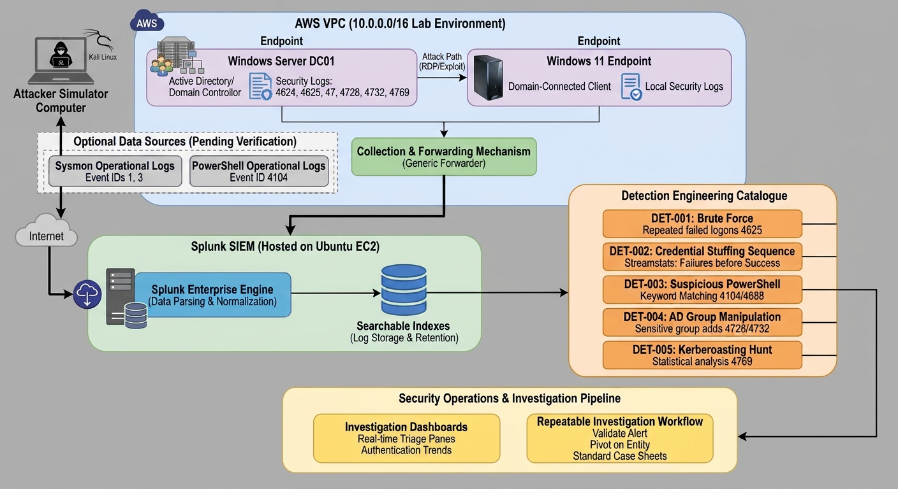

# Enterprise Active Directory Threat Detection and Investigation with Splunk

> **Controlled lab and portfolio project — implementation in progress**
>
> A practical blue-team engineering project for validating Windows/Active Directory telemetry, developing SPL detections, correlating events, and documenting investigations with evidence.

## Project overview

Active Directory (AD) is a high-value identity service in many Windows environments. Authentication failures, unexpected privilege changes, Kerberos activity, remote logons, and suspicious process execution can indicate account compromise or movement between systems. A SIEM helps analysts examine these signals across users, hosts, and time.

This project uses **Splunk Enterprise on Ubuntu EC2**, a Windows Server domain controller (**DC01**), an AD domain documented as `corp.local`, and a Windows 11 workstation in an AWS VPC documented as `10.0.0.0/16`.

**This is not a production deployment.** Splunk is reported to be running and Windows telemetry is reported to be indexed, but actual index names, sourcetypes, event coverage, field extractions, detections, and test results must be verified. This README deliberately distinguishes planned work from observed results.

### Objectives

- Verify the collection path and Windows telemetry available to Splunk.
- Discover actual indexes, hosts, sourcetypes, event IDs, fields, and timestamp behavior.
- Develop readable SPL detections with documented assumptions and limitations.
- Correlate authentication, privilege, process, and network evidence into timelines.
- Validate detection logic using authorized, controlled lab activity.
- Record false positives, coverage gaps, investigation conclusions, and evidence.
- Version-control searches, test cases, and documentation.

### Skills demonstrated

Splunk Enterprise and SPL; Windows Security auditing; Active Directory security; detection engineering; threat hunting; event correlation; MITRE ATT&CK mapping; incident investigation; AWS lab security; Git and technical documentation.


## Architecture




*Figure 1 — Placeholder: capture a rendered architecture diagram of the implemented design.*

| Component | Role | Security considerations |
|---|---|---|
| DC01 | AD DS and domain-controller event source | Protect privileged access; audit only what is required; sanitize account/domain details |
| Windows 11 endpoint | Endpoint authentication and process event source | Verify domain membership, audit policy, and generated events |
| Collection/forwarding mechanism | Sends events to Splunk | Not assumed here; document the actual mechanism, configuration, transport, and health checks |
| Splunk Enterprise on Ubuntu EC2 | Receives, indexes, searches, and correlates events | Restrict access; use strong authentication and supported updates; avoid uncontrolled public exposure |
| SPL detections | Apply explicit logic to telemetry | Validate against benign baselines and controlled test cases |
| Dashboards and reports | Support analyst triage and documentation | Limit access to sensitive log data and sanitize public evidence |

## Lab environment and prerequisites

| Component | Purpose | Verification |
|---|---|---|
| AWS account and EC2 access | Host Splunk and support the lab network | Confirm authorized console/SSH access and instance state |
| Ubuntu EC2 | Runs Splunk Enterprise | Check OS, service health, storage, and resources |
| Splunk Enterprise | Search and analyze telemetry | Open Splunk Web and Search & Reporting; record version |
| Windows Server DC01 | AD DS and domain-controller telemetry | Verify domain role, DNS, and Security log access |
| Windows 11 workstation | Endpoint telemetry and domain logons | Verify domain membership, DNS, and event generation |
| Collection path | Ingest Windows events | Identify the actual forwarder, input, add-on, or other mechanism |
| Appropriate permissions | Inspect logs and configure auditing/collection | Use least privilege; elevate only for administrative changes |
| Git and GitHub | Version-control project artefacts | `git --version`; inspect staged files for secrets |

### Lab inventory

Fill in actual values from the environment. Do not publish public IPs, AWS account IDs, credentials, private keys, VPN configuration, or unnecessary internal details.

| Hostname | Operating system | Role | Private IP | Status |
|---|---|---|---|---|
| `SPLUNK_HOST` | Ubuntu (record actual version) | Splunk Enterprise | `<verified-private-IP>` | Reported running; verify |
| `DC01` | Windows Server (record actual build) | AD DS / DNS | `<verified-private-IP>` | Existing; verify |
| `WIN11-CLIENT` | Windows 11 (record actual build) | Domain-connected endpoint | `<verified-private-IP>` | Verify membership and telemetry |

The lab VPC is documented as using `10.0.0.0/16`. Verify live addresses and subnet assignments before recording them. Use sanitized values in public documentation.

## Initial setup and deployment

Complete these steps in sequence. Save actual outputs and evidence before marking a stage **Verified**.

### Step 1 — Prepare the AWS environment

1. Confirm instances are running and reachable through approved access paths.
2. Verify routes, security groups, network ACLs, host firewalls, DNS, and the intended collection path.
3. Determine required ports from the collection mechanism actually in use; do not open broad inbound access to make a test pass.
4. Restrict Splunk Web to a trusted source IP, VPN, or private access path. Avoid exposing it publicly without appropriate access controls.
5. Record host roles and private addresses locally, then sanitize public evidence.

Illustrative Ubuntu checks (adapt to the host and installation):

```bash
cat /etc/os-release
ip -brief address
ip route
sudo ss -lntup
```

These commands inspect the host; they do not prove that Windows telemetry reaches Splunk.

### Step 2 — Verify Splunk Enterprise

Open Splunk Web through the configured trusted access path. Sign in and confirm **Search & Reporting** is available.

For a common package installation path, run:

```bash
sudo /opt/splunk/bin/splunk version
sudo /opt/splunk/bin/splunk status
```

Adapt the path or service command if the installation differs. Record the actual version and status. Redact usernames, host details, tokens, and other sensitive values from screenshots.


*Figure 2 — Placeholder: capture the actual Splunk version, healthy service state, and Search & Reporting access. Produce during Step 2; do not claim a healthy result until verified.*

### Step 3 — Verify Active Directory and domain connectivity

On DC01, use PowerShell:

```powershell
Get-ComputerInfo |
    Select-Object CsName, WindowsProductName, WindowsVersion, OsBuildNumber

Get-Service NTDS, DNS

Get-ADDomain |
    Select-Object DNSRoot, NetBIOSName, DomainMode

Get-ADDomainController -Identity $env:COMPUTERNAME |
    Select-Object HostName, IPv4Address, Site
```

The AD cmdlets require the Active Directory PowerShell module. If unavailable, record that limitation and use an approved method to obtain the management tools.

On the Windows 11 endpoint:

```powershell
Get-ComputerInfo |
    Select-Object CsName, WindowsProductName, WindowsVersion, OsBuildNumber

Get-CimInstance Win32_ComputerSystem |
    Select-Object Name, Domain, PartOfDomain

ipconfig /all
Resolve-DnsName corp.local
```

Adapt the domain suffix if the actual lab differs. Confirm the endpoint uses the intended DNS resolver and can locate the domain. DNS resolution alone does not prove telemetry ingestion.

Inspect effective audit policy (read-only; elevated shell may be needed to see all settings):

```powershell
auditpol /get /category:*
```

Make audit-policy changes only in the authorized lab, after recording the existing state and considering event volume.

### Step 4 — Verify Windows telemetry ingestion in Splunk

Do not assume an index such as `wineventlog`, `windows`, or `main`. In Search & Reporting, set an appropriate time range and run:

```spl
| tstats count WHERE index=* BY index
| sort - count
```

This summarizes indexed event counts for indexes visible to the current user; it does not identify Windows data by itself.

```spl
index=*
| stats count BY index host sourcetype source
| sort - count
```

Use the results to identify candidate Windows indexes, host values, sourcetypes, and sources. Permissions and search scope may limit results.

After confirming an actual index:

```spl
index=YOUR_INDEX
| head 20
| table _time host source sourcetype _raw
```

Replace `YOUR_INDEX` with a verified value and narrow the search to the actual DC01 and endpoint host values. Set a time range that includes when events should have been generated. If Splunk's `host` value differs from the Windows computer name, record the actual mapping.


*Figure 3 — Placeholder: capture actual index/host/sourcetype/source discovery results. Produce during Step 4. The screenshot must prove what Splunk can see, not what is expected to exist.*


*Figure 4 — Placeholder: capture sanitized raw Windows events from a verified host and time range. Produce during Step 4. Redact sensitive account, domain, address, and infrastructure details where necessary.*

If no events appear, check the time range, search permissions, index, host mapping, collection service, forwarding configuration, network path, source-side event generation, and retention. Absence from a search is not proof that an activity did not occur.

### Step 5 — Validate Windows Security event coverage

Check whether the following event IDs are present. Availability depends on audit policy, source role, collection configuration, permissions, and retention.

```spl
index=YOUR_INDEX (EventCode=4624 OR EventCode=4625 OR EventCode=4672 OR
                  EventCode=4728 OR EventCode=4732 OR EventCode=4769 OR
                  EventCode=4688)
| stats count min(_time) AS first_seen max(_time) AS last_seen
    BY host sourcetype EventCode
| convert ctime(first_seen) ctime(last_seen)
| sort host EventCode
```

This example assumes `EventCode`. Some inputs use `EventID`, another field, or expose the ID only in raw XML/text. Inspect raw events and adapt the query.

- **4624** — successful logon
- **4625** — failed logon
- **4672** — special privileges assigned to a new logon
- **4728** — member added to a security-enabled global group
- **4732** — member added to a security-enabled local group
- **4769** — Kerberos service ticket requested
- **4688** — process creation, if the relevant audit policy is enabled

Event presence does not guarantee that all required fields are extracted correctly.

### Step 6 — Validate Sysmon and PowerShell telemetry

Keep four states separate:

1. **Installed** — software/feature exists on the source.
2. **Configured** — required policy/configuration is active.
3. **Ingested** — events reach Splunk.
4. **Validated** — a controlled test produces the expected event and fields.

Sysmon may provide process creation (Event ID 1) and network connection (Event ID 3), depending on configuration. PowerShell Script Block Logging commonly uses Event ID 4104 in the relevant operational channel. Security Event ID 4688 records process creation when the corresponding audit policy is enabled. Treat Sysmon and PowerShell sources as optional until verified.

On a Windows endpoint:

```powershell
Get-WinEvent -ListLog *Sysmon* |
    Select-Object LogName, IsEnabled, RecordCount

Get-WinEvent -ListLog *PowerShell* |
    Select-Object LogName, IsEnabled, RecordCount
```

To inspect recent local PowerShell events, if that channel exists:

```powershell
Get-WinEvent -LogName 'Microsoft-Windows-PowerShell/Operational' -MaxEvents 20 |
    Select-Object TimeCreated, Id, ProviderName, Message
```

Then search Splunk using the discovered index, sourcetype, host, and event field. Installation alone does not prove that telemetry is configured, ingested, or validated.

### Step 7 — Save and version-control the project

Create directories as work is implemented:

```bash
mkdir -p architecture \
  detections/authentication detections/powershell \
  detections/active-directory detections/kerberos \
  detections/lateral-movement dashboards investigations \
  test-cases evidence/screenshots docs

git init
git status
```

Before committing, inspect files for secrets:

```bash
git status --short
git diff --cached
```

Use a `.gitignore` for editor files, local configuration, logs, and temporary artefacts. Never commit credentials, tokens, private keys, AWS access keys, VPN files, or unsanitized sensitive logs.

## Telemetry and data model

| Event/source | Security purpose | Useful fields to verify | Possible use |
|---|---|---|---|
| Security 4624 | Successful logon | Target account, logon type, workstation, source address, time | Baseline and post-failure success |
| Security 4625 | Failed logon | Account, logon type, source address, status/substatus | Repeated failures |
| Security 4672 | Special privileges assigned | Account, logon ID, privileges | Privileged-session context |
| Security 4728 | Global security group membership added | Actor, target member, group, time | Sensitive group changes |
| Security 4732 | Local security group membership added | Actor, target member, group, time | Local group changes |
| Security 4769 | Kerberos service ticket requested | Requesting account, service, client address, ticket attributes if present | Unusual ticket-request patterns |
| Security 4688 | Process creation | New process, creator, command line if configured, process ID | Suspicious execution |
| Sysmon 1 (optional) | Process creation | Image, command line, parent image, user, hashes if configured | Process ancestry |
| Sysmon 3 (optional) | Network connection | Process, destination, port, protocol | Process/network pivots |
| PowerShell 4104 (optional) | Script block logging | Script text, user, host, time | Script investigation |
| System 7045 / Security 4697 (where available) | Service installation | Service name, image path, context where available | Possible persistence |

Field names differ across event formats, add-ons, and sourcetypes. Names such as `src_ip`, `user`, `EventCode`, `Account_Name`, `TargetUserName`, `SubjectUserName`, `IpAddress`, and `LogonType` are examples—not universal fields. Inspect raw events before using them, and preserve semantic distinctions when normalizing fields.

### Timestamp and data quality

- Compare Splunk `_time` with original event timestamps where available.
- Verify source timezone, Splunk timezone settings, daylight-saving handling, and forwarding delay.
- Use an explicit time picker and record the timezone in investigations.
- Account for ingestion latency in correlation windows.
- Check for missing, duplicated, delayed, truncated, or malformed events.
- Verify host/account naming, field population, permissions, and retention.
- Record whether missing telemetry is due to audit policy, collection, field extraction, or retention.

## Detection engineering catalogue

The searches below are **templates, not verified detections**. Replace `YOUR_INDEX`, adapt event IDs and field names to observed data, and test against benign baselines and controlled activity. Save each finalized search with its assumptions, version, validation procedure, and result.

### Common adaptation checklist

1. Replace `YOUR_INDEX` with a verified index.
2. Confirm event-ID field and values.
3. Confirm account, source-address, host, logon-type, process, and service fields.
4. Use an explicit time range and relevant hosts during validation.
5. Check for null fields and duplicates.
6. Tune thresholds to observed baseline activity.
7. Preserve the raw events supporting any conclusion.

### DET-001 — Repeated failed logons

- **Objective:** Identify a high volume of failures associated with an account and source.
- **Hypothesis:** Password guessing, brute force, stale credentials, or an application misconfiguration.
- **Telemetry:** Security 4625.
- **Fields:** Account and source address, after verification.
- **ATT&CK:** T1110 — Brute Force, as a hypothesis only when context supports it.
- **Severity:** Medium by default; increase for privileged accounts, unusual sources, broad targeting, or a subsequent success.
- **Limitations / false positives:** Expired saved credentials, scheduled tasks, applications, user error, NAT, and shared source addresses can create clusters. A threshold is not proof of malicious activity.

```spl
index=YOUR_INDEX EventCode=4625
| bin _time span=5m
| stats count AS failures values(host) AS hosts BY _time TargetUserName IpAddress
| where failures >= 10
| sort - failures
```

**How it works:** Counts failures in five-minute buckets by account and source address. `TargetUserName` and `IpAddress` are example fields; confirm them. The threshold is illustrative and must be tuned.

**Validation:** Generate a small, controlled number of failed logons against a lab account using normal Windows sign-in, taking care not to trigger account lockout. Verify raw 4625 events before evaluating the threshold.


*Figure 5 — Placeholder: capture the actual search, time range, results, and supporting raw events after DET-001 testing.*

### DET-002 — Failed logons followed by a successful logon

- **Objective:** Find an account/source combination with failures followed by success.
- **Hypothesis:** An account may eventually authenticate after guessing attempts; user mistakes and saved credentials can also cause this pattern.
- **Telemetry:** Security 4625 and 4624.
- **Fields:** Comparable normalized account and source values.
- **ATT&CK:** T1110 may apply if other evidence supports password guessing.
- **Severity:** Medium; raise for privileged accounts, unusual sources, or suspicious post-authentication activity.
- **Limitations / false positives:** Source fields may be blank or inconsistent. A simple previous-event method can miss a failure if another event intervenes.

```spl
index=YOUR_INDEX (EventCode=4625 OR EventCode=4624)
| eval event_kind=case(EventCode=4625,"failure", EventCode=4624,"success")
| eval account=coalesce(TargetUserName, Account_Name, user)
| eval src=coalesce(IpAddress, src_ip, Source_Network_Address)
| where isnotnull(account)
| sort 0 account src _time
| streamstats current=f last(event_kind) AS previous_kind last(_time) AS previous_time BY account src
| where event_kind="success" AND previous_kind="failure" AND (_time-previous_time)<=900
| eval delay_seconds=_time-previous_time
| table _time host account src previous_time delay_seconds event_kind
```

**How it works:** Normalizes candidate fields, orders events by account/source/time, and looks for a success whose immediately preceding event in that group was a failure within 15 minutes. This is a simple hunting template, not a complete production correlation. A stronger version should aggregate failures in a defined window and correlate them with later successes.

**Validation:** Verify raw 4625 and 4624 events and matching field values. Perform a controlled failed sign-in followed by a successful sign-in for the same lab account/source, then inspect the timeline.

### DET-003 — Suspicious PowerShell activity

- **Objective:** Surface script blocks or process events with patterns requiring review.
- **Hypothesis:** PowerShell can support legitimate administration or suspicious execution, discovery, and defense evasion.
- **Telemetry:** PowerShell 4104, Security 4688, and/or Sysmon 1, if collected.
- **Fields:** Script-block text or command line, account, host, process.
- **ATT&CK:** T1059.001 — PowerShell, when supported by the observed behavior.
- **Severity:** Context-dependent; a string match alone is not proof of compromise.
- **Limitations / false positives:** Administrative scripts may match; script blocks can be split or absent.

```spl
index=YOUR_INDEX (EventCode=4104 OR EventCode=4688 OR EventID=1)
| eval detail=lower(coalesce(ScriptBlockText, Message, CommandLine, Process_Command_Line, _raw))
| where match(detail, "(encodedcommand|frombase64string|downloadstring|invoke-expression|\\biex\\b)")
| table _time host user Account_Name EventCode EventID detail
| sort - _time
```

**How it works:** Searches available text for illustrative patterns. It may match benign activity and miss obfuscated or differently represented commands. Adapt fields and event IDs. Avoid publishing sensitive script content.

**Validation:** Use a harmless, documented lab command that generates the expected event without downloading payloads or changing security settings. Verify local event generation and Splunk ingestion separately.


*Figure 7 — Placeholder: capture a verified PowerShell/process event and corresponding search result after optional telemetry is configured and validated.*

### DET-004 — Sensitive group membership changes

- **Objective:** Identify additions to security groups for review.
- **Hypothesis:** An account may gain access through an unauthorized group change.
- **Telemetry:** Security 4728 and 4732.
- **Fields:** Actor, target member, group, host, timestamp.
- **ATT&CK:** T1098 — Account Manipulation may apply depending on the observed action.
- **Severity:** High if a privileged group is changed without an approved reason; otherwise contextual.
- **Limitations / false positives:** Approved administration and identity lifecycle workflows generate legitimate changes. Event fields vary by event type.

```spl
index=YOUR_INDEX (EventCode=4728 OR EventCode=4732)
| eval actor=coalesce(SubjectUserName, Account_Name, user)
| eval target_member=coalesce(MemberName, TargetUserName)
| eval changed_group=coalesce(TargetUserName, Group_Name, GroupName)
| table _time host EventCode actor target_member changed_group _raw
| sort - _time
```

**How it works:** Lists candidate group additions and includes raw event content for validation. Verify which fields represent the actor, member, and group in each event before relying on aliases.

**Validation:** Add a test account to a designated test group through an approved administrative action. Verify the domain-controller event and its appearance in Splunk. Do not modify production or highly privileged groups for a demonstration.


*Figure 8 — Placeholder: capture a sanitized, verified group membership-change event and relevant fields after DET-004 validation.*

### DET-005 — Unusual Kerberos service-ticket requests / potential Kerberoasting

- **Objective:** Identify unusual service-ticket request volume or diversity for investigation.
- **Hypothesis:** Unusual ticket-request patterns may be consistent with reconnaissance or Kerberoasting; Event 4769 alone is not proof.
- **Telemetry:** Security 4769.
- **Fields:** Requesting account, service name, client address, ticket/encryption attributes where available.
- **ATT&CK:** T1558.003 — Kerberoasting, only where supported by evidence.
- **Severity:** Medium initially; increase with unusual volume, sensitive service accounts, anomalous attributes, and corroborating events.
- **Limitations / false positives:** Applications, scheduled tasks, and normal service discovery can create many tickets; field availability varies.

```spl
index=YOUR_INDEX EventCode=4769
| bin _time span=10m
| stats count AS ticket_requests dc(ServiceName) AS distinct_services
    values(ServiceName) AS services BY _time Account_Name IpAddress
| where ticket_requests >= 20 OR distinct_services >= 10
| sort - ticket_requests
```

**How it works:** Groups requests into ten-minute windows and flags illustrative volume/diversity thresholds. Verify `Account_Name`, `ServiceName`, and `IpAddress`; tune thresholds to a baseline.

**Validation:** Establish normal lab Kerberos activity first. If running a controlled simulation, document authorization, expected telemetry, observed results, and cleanup. Do not infer Kerberoasting from volume alone.

### DET-006 — Suspicious remote logons and lateral movement

- **Objective:** Find remote logons for review and pivot into subsequent activity on destination hosts.
- **Hypothesis:** A compromised identity may authenticate to additional hosts or use remote services.
- **Telemetry:** Security 4624 with logon type and source fields; correlate with process/service events only if collected.
- **Fields:** Account, source address, host, logon type.
- **ATT&CK:** T1021 (Remote Services) may apply when a specific remote-service behavior is evidenced. Logon type alone does not establish a sub-technique.
- **Severity:** Medium for unusual remote access; higher for privileged accounts, unexpected hosts, or corroborating execution.
- **Limitations / false positives:** IT administration, jump hosts, service accounts, and management tools generate legitimate remote logons.

```spl
index=YOUR_INDEX EventCode=4624
| eval account=coalesce(TargetUserName, Account_Name, user)
| eval src=coalesce(IpAddress, src_ip, Source_Network_Address)
| eval logon_type=coalesce(LogonType, Logon_Type)
| where logon_type IN ("3","10",3,10) AND isnotnull(account)
| table _time host account src logon_type AuthenticationPackageName _raw
| sort - _time
```

**How it works:** Lists network (type 3) and remote interactive (type 10) logons when those values are present. This is a hunting pivot, not a standalone lateral-movement verdict. Confirm the field format and correlate destination-host activity.

**Validation:** Perform a normal, authorized remote-access action between lab systems, if appropriate, and verify the resulting logon events and source/destination interpretation.

### DET-007 — New service installation / possible persistence

- **Objective:** Find service installation events for review.
- **Hypothesis:** Services can be used for legitimate software installation or as persistence/execution mechanisms.
- **Telemetry:** System 7045 and/or Security 4697, if collected.
- **Fields:** Service name, image path, time, host, actor/context where available.
- **ATT&CK:** T1543.003 — Windows Service, when supported by the evidence.
- **Severity:** Medium by default; raise for unexpected binaries, suspicious paths, privileged context, or correlated activity.
- **Limitations / false positives:** Software installation, updates, and approved administration create services. Sources may capture different event types.

```spl
index=YOUR_INDEX (EventCode=7045 OR EventCode=4697)
| table _time host EventCode ServiceName ImagePath ServiceFileName Account_Name _raw
| sort - _time
```

**How it works:** Retrieves candidate service-installation events and displays possible fields. Confirm field names against raw events; the raw event remains the source of truth.

**Validation:** If needed, use a disposable lab endpoint and an approved benign service-installation test. Verify the event locally and in Splunk, and document cleanup.

### DET-008 — Suspicious process execution

- **Objective:** Find selected process names or command-line patterns for review.
- **Hypothesis:** Unusual process chains or utilities may be suspicious when combined with unexpected parents, accounts, or network activity.
- **Telemetry:** Security 4688 and/or Sysmon 1, if collected.
- **Fields:** Process image, command line, parent, account, host, time.
- **ATT&CK:** Map only after the behavior—not just the process name—supports a technique.
- **Severity:** Context-dependent; process names alone are weak signals.
- **Limitations / false positives:** Administrative tools and installers can match. Command-line collection may be disabled.

```spl
index=YOUR_INDEX (EventCode=4688 OR EventID=1)
| eval process_detail=lower(coalesce(NewProcessName, Image, ProcessName, CommandLine, _raw))
| where match(process_detail, "(\\bpsexec(\\.exe)?\\b|\\brundll32\\.exe\\b|\\bregsvr32\\.exe\\b|\\bwmic\\.exe\\b)")
| table _time host user Account_Name EventCode EventID process_detail ParentProcessName ParentImage
| sort - _time
```

**How it works:** Searches candidate fields for selected process names. The list is illustrative and neither exhaustive nor inherently malicious. Verify extraction and tune against baseline.

**Validation:** Generate an approved benign process event and verify event ID, process image, parent, and account fields. Document the exact test and actual result.

## Event correlation and investigation methodology

Use a repeatable workflow and keep conclusions proportional to evidence.

| Question | Establish | Useful pivots |
|---|---|---|
| **What happened?** | Exact event and detection condition | Raw event, event ID, process/service details |
| **Who was involved?** | Actor, target account, privileges, identities | Account, logon ID, subject/target fields |
| **When did it happen?** | Sequence, first/last event, duration | `_time`, source timestamp, timeline |
| **Where did it originate?** | Source and affected assets | Host, source address, destination, workstation |
| **Why is it suspicious?** | Baseline deviation or policy violation | Frequency, novelty, threat hypothesis, context |
| **How far did it spread?** | Other accounts, hosts, and processes involved | Account/host pivots, logons, process/network events |
| **What was the impact?** | Access gained and affected systems, supported by evidence | Privilege changes, subsequent activity, asset criticality |

### Investigation workflow

1. Validate the alert logic, time range, matched fields, raw events, and event count.
2. Establish baseline behavior for the account, source, host, and time.
3. Build a timeline; account for timezone differences and ingestion delay.
4. Pivot on identity using account and logon ID where available.
5. Pivot across source and destination hosts in a defined time window.
6. Inspect process, service, PowerShell, or network context only where telemetry is available.
7. Determine scope and impact; separate facts from hypotheses.
8. Recommend proportionate response under the lab rules and applicable procedures.
9. Record the conclusion, confidence, false-positive assessment, gaps, and evidence references.

### Correlation search template

This search creates a basic timeline from common authentication, privilege, and process events. Adapt event IDs and field names to your actual data.

```spl
index=YOUR_INDEX (EventCode=4624 OR EventCode=4625 OR EventCode=4672 OR
                  EventCode=4728 OR EventCode=4732 OR EventCode=4688)
| eval account=coalesce(TargetUserName, SubjectUserName, Account_Name, user)
| eval event_label=case(
    EventCode=4624,"Successful logon",
    EventCode=4625,"Failed logon",
    EventCode=4672,"Special privileges assigned",
    EventCode=4728,"Global group membership added",
    EventCode=4732,"Local group membership added",
    EventCode=4688,"Process created",
    true(),"Other")
| table _time host account EventCode event_label _raw
| sort 0 _time
```

This is a timeline pivot, not proof that the events belong to one incident. Strengthen correlation with verified logon IDs, source/destination values, and appropriate time windows. Avoid joining unrelated events solely because they share an account name.


*Figure 6 — Placeholder: capture a verified correlation search and supporting raw events that show the timeline. Produce after correlation logic has been tested.*

### Investigation worksheet

```text
Alert ID:
Detection name:
Analyst:
Time range and timezone:
Affected host(s):
Account(s):
Source address(es):
Supporting event IDs and references:
Timeline:
What happened:
Who was involved:
Where activity originated / affected assets:
Why suspicious:
How far activity spread:
Impact assessment:
Scope:
Benign explanation / false-positive assessment:
Confidence: Low / Medium / High (explain why)
Containment recommendations:
Evidence references:
Data gaps / limitations:
Analyst conclusion:
Disposition: True positive / False positive / Inconclusive
```

## Threat simulation and detection validation

Only test systems you own or are explicitly authorized to assess. Begin with benign, low-impact scenarios and define expected telemetry before running each test. Never fill actual-result or pass/fail fields from expectation alone.

| Test ID | Scenario | Preconditions | Test procedure | Expected telemetry | Expected detection | Actual result | Evidence | Status |
|---|---|---|---|---|---|---|---|---|
| VAL-001 | Controlled failed logons | 4625 collection verified; lockout risk understood | Perform a small number of failed sign-ins on a lab account | 4625 events | DET-001 if threshold is met | Pending validation | Pending | Pending |
| VAL-002 | Failure followed by success | 4625 and 4624 visible; fields comparable | Controlled failed sign-in then successful sign-in | 4625 then 4624 | DET-002 if logic/window matches | Pending validation | Pending | Pending |
| VAL-003 | Benign PowerShell event | PowerShell telemetry configured and ingested | Run a harmless documented command | Expected PowerShell/process event | DET-003 only if the pattern matches | Pending validation | Pending | Pending |
| VAL-004 | Test-group membership change | DC audit event collection verified; test group/account available | Add a test account to a designated test group | 4728 or 4732 as applicable | DET-004 candidate event | Pending validation | Pending | Pending |
| VAL-005 | Normal Kerberos baseline | 4769 collection verified | Observe normal lab authentication/application activity | 4769 events if generated | Baseline only; anomaly requires context | Pending validation | Pending | Pending |
| VAL-006 | Authorized remote logon | Source/destination lab systems available | Perform normal approved remote access | 4624 with applicable logon type | DET-006 hunting result | Pending validation | Pending | Pending |
| VAL-007 | Benign service installation | Disposable endpoint; approved test and cleanup plan | Install a benign test service if needed | 7045 and/or 4697 if audited | DET-007 candidate event | Pending validation | Pending | Pending |
| VAL-008 | Benign process execution | Process telemetry verified | Launch a documented benign process | 4688 and/or Sysmon 1 | DET-008 only if the pattern matches | Pending validation | Pending | Pending |

### Validation acceptance criteria

For each test, capture:

- Test ID, date/time, timezone, source host, and preconditions.
- Exact action performed and the expected event(s).
- Raw source event and corresponding Splunk result.
- Whether required fields were populated.
- Whether the detection matched within the intended time window.
- Benign matches, missed matches, and threshold observations.
- Cleanup, if applicable.
- Evidence filename and pass/fail rationale.

A test passes only when the expected telemetry and detection behavior are observed and evidence is saved. If the source event is absent, investigate telemetry first; do not label the detection itself as failed without identifying which stage failed.


*Figure 10 — Placeholder: capture the completed test matrix and supporting Splunk results. Produce after tests are executed; until then, results remain pending.*

## Dashboards and reporting

A planned dashboard can provide an overview of identity and endpoint signals. Build panels only after their source fields and searches are validated.

| Panel | Purpose | Status |
|---|---|---|
| Authentication failures over time | Show failure volume and changes in baseline | Planned |
| Successful logons | Review successful authentication trends | Planned |
| Repeated failures by account/source | Prioritize repeated failure clusters | Planned |
| Privilege/group changes | Review sensitive membership changes | Planned |
| Suspicious PowerShell activity | Surface candidate script/process events | Planned; requires telemetry |
| Detection severity and trends | Summarize validated detections by severity/time | Planned |
| Investigations requiring review | Track open, inconclusive, or high-confidence cases | Planned |


*Figure 9 — Placeholder: capture the actual dashboard with sanitized data and visible time range. Produce after dashboard implementation; do not present this placeholder as an existing dashboard.*

For each panel, document the SPL, source/index assumptions, time range, refresh behavior, known limitations, and what an analyst should do when it changes. Do not label every threshold match as an incident.

## Evidence and screenshots

Use relative paths from the repository root. The screenshot files are **placeholders until captured**; do not fabricate images or commit empty files as evidence.

```text
evidence/
└── screenshots/
    ├── 01-architecture.png
    ├── 02-splunk-health.png
    ├── 03-index-discovery.png
    ├── 04-windows-raw-events.png
    ├── 05-brute-force-detection.png
    ├── 06-correlation-investigation.png
    ├── 07-powershell-detection.png
    ├── 08-ad-privilege-changes.png
    ├── 09-soc-dashboard.png
    └── 10-validation-results.png
```

| File | What it should prove | Produce during |
|---|---|---|
| `01-architecture.png` | Actual architecture and verified collection path | Architecture documentation |
| `02-splunk-health.png` | Splunk version, service health, Search & Reporting | Initial setup, Step 2 |
| `03-index-discovery.png` | Actual index/host/sourcetype/source results | Ingestion verification, Step 4 |
| `04-windows-raw-events.png` | Real, sanitized Windows raw events | Ingestion verification, Step 4 |
| `05-brute-force-detection.png` | Actual DET-001 search and supporting events | DET-001 validation |
| `06-correlation-investigation.png` | Correlation search and event timeline | Correlation validation |
| `07-powershell-detection.png` | Verified PowerShell/process event and search | Optional telemetry validation |
| `08-ad-privilege-changes.png` | Verified sanitized group-change event | DET-004 validation |
| `09-soc-dashboard.png` | Implemented dashboard and time range | Dashboard implementation |
| `10-validation-results.png` | Completed validation results with evidence | Test execution |

Redact credentials, tokens, public IPs, AWS account identifiers, private keys, VPN details, and sensitive account/domain data. Keep uncollected evidence marked **Pending** in the project notes.

## Repository structure

Create folders as their contents are implemented; this is a proposed layout.

```text
splunk-ad-threat-detection/
├── README.md
├── architecture/
│   └── architecture.mmd
├── detections/
│   ├── authentication/
│   ├── powershell/
│   ├── active-directory/
│   ├── kerberos/
│   └── lateral-movement/
├── dashboards/
├── investigations/
├── test-cases/
├── evidence/
│   └── screenshots/
├── docs/
│   ├── setup.md
│   ├── telemetry.md
│   └── validation.md
└── LICENSE
```

- `architecture/` — Mermaid source and design notes.
- `detections/` — one documented SPL file per detection, including assumptions and test status.
- `dashboards/` — dashboard definitions/exports and panel notes, if exported.
- `investigations/` — sanitized case reports and timelines.
- `test-cases/` — test procedures, expected telemetry, actual results, and evidence references.
- `evidence/screenshots/` — sanitized screenshots that actually exist.
- `docs/` — setup, telemetry, validation, and operating notes.
- `LICENSE` — choose a license appropriate for the code and documentation.

## Results and evaluation

**Current results: Pending validation.** Populate this table only from completed tests and saved evidence.

| Metric | Result |
|---|---|
| Detections implemented | Pending validation |
| Tests executed | Pending validation |
| Tests passed | Pending validation |
| Tests failed | Pending validation |
| False-positive observations | Pending validation |
| Telemetry coverage by event/source | Pending validation |
| Detection limitations and known gaps | Document during validation |

Do not report detection accuracy, performance percentages, alert counts, or successful outcomes without reproducible evidence. Distinguish a telemetry failure from a detection-logic failure.

## Security and ethical considerations

- Use the lab only for authorized learning and validation.
- Secure AWS access paths and restrict Splunk Web access.
- Use least privilege and document administrative changes.
- Sanitize screenshots, logs, account names, addresses, and host details before publication.
- Never commit passwords, tokens, private keys, AWS credentials, VPN files, or sensitive raw logs.
- Do not test production or third-party environments without explicit authorization.
- Keep enough evidence to support conclusions while avoiding unnecessary disclosure of sensitive data.

## Limitations and future improvements

Known limitations at this stage include unverified index/sourcetype mappings, field extraction, event coverage, collection configuration, detection outcomes, and dashboard status. SPL templates require adaptation and validation before operational use.

Planned improvements:

- Normalize event fields after confirming their meaning and source.
- Establish baseline behavior and tune thresholds to reduce false positives.
- Add risk-based prioritization using corroborating evidence.
- Build reusable detection tests and regression checks.
- Automate incident enrichment where appropriate.
- Evaluate Sigma portability for suitable detections.
- Consider integration with Wazuh or other security tools.
- Add detection-as-code validation in CI.
- Track telemetry health, ingestion delays, and coverage gaps.

These are future enhancements, not completed capabilities.

## Conclusion

This project is designed to demonstrate an evidence-led detection engineering lifecycle: verify telemetry, develop and explain SPL, correlate events, validate with controlled lab activity, investigate results, and document limitations. Its value to employers depends on transparent implementation status, reproducible searches, sound analysis, and real supporting evidence—not the number of detection ideas listed.

**Portfolio summary:** *Enterprise Active Directory Threat Detection and Investigation with Splunk — a controlled lab project focused on Windows telemetry validation, SPL detection engineering, event correlation, threat hunting, and evidence-based SOC investigation. Implementation status and results are reported only when verified.*
