# Enterprise Active Directory Threat Detection and Investigation with Splunk

> **Controlled lab and portfolio project implementation in progress**
>
> A practical blue-team engineering project for validating Windows/Active Directory telemetry, developing SPL detections, correlating events, and documenting investigations with evidence.

## Project overview

Active Directory (AD) is a high-value identity service in many Windows environments. Authentication failures, unexpected privilege changes, Kerberos activity, remote logons, and suspicious process execution can indicate account compromise or movement between systems. A SIEM helps analysts examine these signals across users, hosts, and time.

This project uses **Splunk Enterprise on Ubuntu EC2**, a Windows Server domain controller (**DC01**), an AD domain documented as `corp.local`, and a Windows 11 workstation in an AWS VPC.

### Objectives

- Verify the collection path and Windows telemetry available to Splunk.
- Discover actual indexes, hosts, sourcetypes, event IDs, fields, and timestamp behavior.
- Develop readable SPL detections with documented assumptions and limitations.
- Correlate authentication, privilege, process, and network evidence into timelines.
- Validate detection logic using authorized, controlled lab activity.
- Record false positives, coverage gaps, investigation conclusions, and evidence.
- Version-control searches, test cases, and documentation.

### Skills demonstrated

Splunk Enterprise and SPL; Windows Security auditing; Active Directory security; detection engineering; threat hunting; event correlation; MITRE ATT&CK mapping; incident investigation; AWS lab security; Git and technical documentation.


## Architecture


| Component | Role | Security considerations |
|---|---|---|
| DC01 | AD DS and domain-controller event source | Protect privileged access; audit only what is required; sanitize account/domain details |
| Windows 11 endpoint | Endpoint authentication and process event source | Verify domain membership, audit policy, and generated events |
| Collection/forwarding mechanism | Sends events to Splunk | Not assumed here; document the actual mechanism, configuration, transport, and health checks |
| Splunk Enterprise on Ubuntu EC2 | Receives, indexes, searches, and correlates events | Restrict access; use strong authentication and supported updates; avoid uncontrolled public exposure |
| SPL detections | Apply explicit logic to telemetry | Validate against benign baselines and controlled test cases |
| Dashboards and reports | Support analyst triage and documentation | Limit access to sensitive log data and sanitize public evidence |

## Lab environment and prerequisites

| Component | Purpose | Verification |
|---|---|---|
| AWS account and EC2 access | Host Splunk and support the lab network | Confirm authorized console/SSH access and instance state |
| Ubuntu EC2 | Runs Splunk Enterprise | Check OS, service health, storage, and resources |
| Splunk Enterprise | Search and analyze telemetry | Open Splunk Web and Search & Reporting; record version |
| Windows Server DC01 | AD DS and domain-controller telemetry | Verify domain role, DNS, and Security log access |
| Windows 11 workstation | Endpoint telemetry and domain logons | Verify domain membership, DNS, and event generation |
| Collection path | Ingest Windows events | Identify the actual forwarder, input, add-on, or other mechanism |
| Appropriate permissions | Inspect logs and configure auditing/collection | Use least privilege; elevate only for administrative changes |
| Git and GitHub | Version-control project artefacts | `git --version`; inspect staged files for secrets |

### Lab inventory
.

| Hostname | Operating system | Role | Private IP | Status |
|---|---|---|---|---|
| `SPLUNK_HOST` | Ubuntu (record actual version) | Splunk Enterprise | `<verified-private-IP>` | Reported running; verify |
| `DC01` | Windows Server (record actual build) | AD DS / DNS | `<verified-private-IP>` | Existing; verify |
| `WIN11-CLIENT` | Windows 11 (record actual build) | Domain-connected endpoint | `<verified-private-IP>` | Verify membership and telemetry |


## Initial setup and deployment


### Step 1 Prepare the AWS environment

1. Confirm instances are running and reachable through approved access paths.
2. Verify routes, security groups, network ACLs, host firewalls, DNS, and the intended collection path.
3. Determine required ports from the collection mechanism actually in use; do not open broad inbound access to make a test pass.
4. Restrict Splunk Web to a trusted source IP, VPN, or private access path. Avoid exposing it publicly without appropriate access controls.
5. Record host roles and private addresses locally, then sanitize public evidence.

Illustrative Ubuntu checks:

```bash
cat /etc/os-release
ip -brief address
ip route
sudo ss -lntup
```
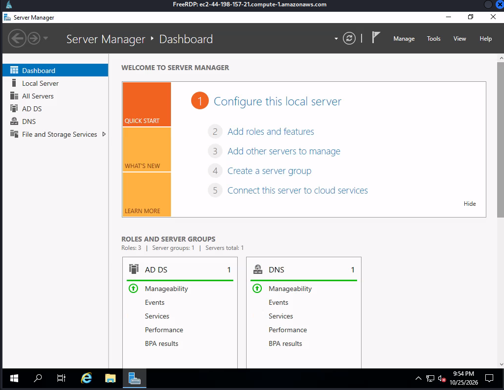
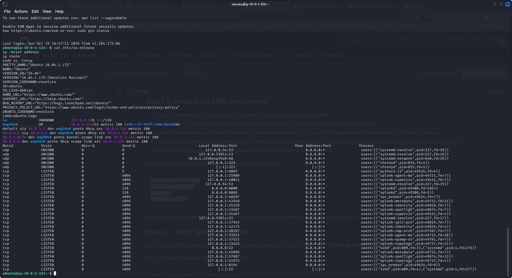


### Step 2 Verify Splunk Enterprise

Open Splunk Web through the configured trusted access path. Sign in and confirm **Search & Reporting** is available.

For a common package installation path, run:

```bash
sudo /opt/splunk/bin/splunk version
sudo /opt/splunk/bin/splunk status
```

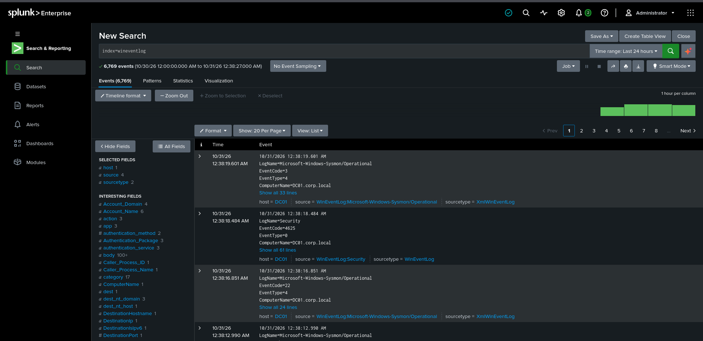

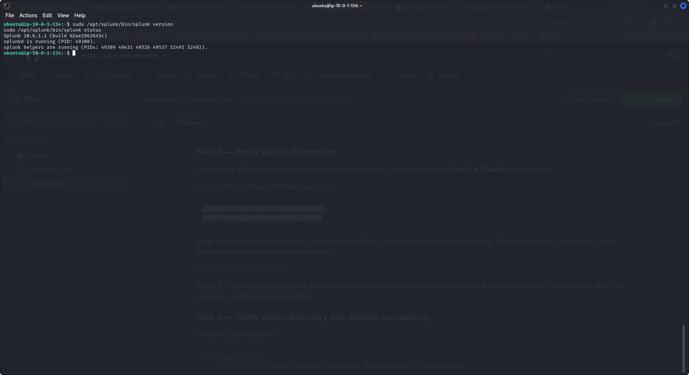


### Step 3 Verify Active Directory and domain connectivity

On DC01, use PowerShell:

```powershell
Get-ComputerInfo |
    Select-Object CsName, WindowsProductName, WindowsVersion, OsBuildNumber

Get-Service NTDS, DNS

Get-ADDomain |
    Select-Object DNSRoot, NetBIOSName, DomainMode

Get-ADDomainController -Identity $env:COMPUTERNAME |
    Select-Object HostName, IPv4Address, Site
```

The AD cmdlets require the Active Directory PowerShell module.

On the Windows 11 endpoint:

```powershell
Get-ComputerInfo |
    Select-Object CsName, WindowsProductName, WindowsVersion, OsBuildNumber

Get-CimInstance Win32_ComputerSystem |
    Select-Object Name, Domain, PartOfDomain

ipconfig /all
Resolve-DnsName corp.local
```

Confirm the endpoint uses the intended DNS resolver and can locate the domain. DNS resolution alone does not prove telemetry ingestion.

Inspect effective audit policy (read-only; elevated shell may be needed to see all settings):

```powershell
auditpol /get /category:*
```

Make audit-policy changes, after recording the existing state and considering event volume.

### Step 4 Verify Windows telemetry ingestion in Splunk

In Search & Reporting, set an appropriate time range and run:

```spl
| tstats count WHERE index=* BY index
| sort - count
```

This summarizes indexed event counts for indexes visible to the current user.

```spl
index=*
| stats count BY index host sourcetype source
| sort - count
```

After confirming an actual index:

```spl
index=*
| head 20
| table _time host source sourcetype _raw
```

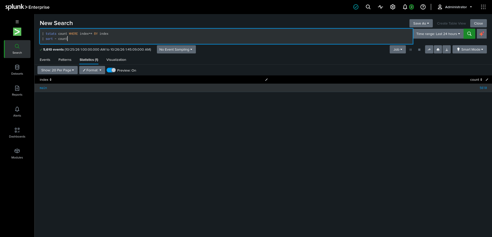


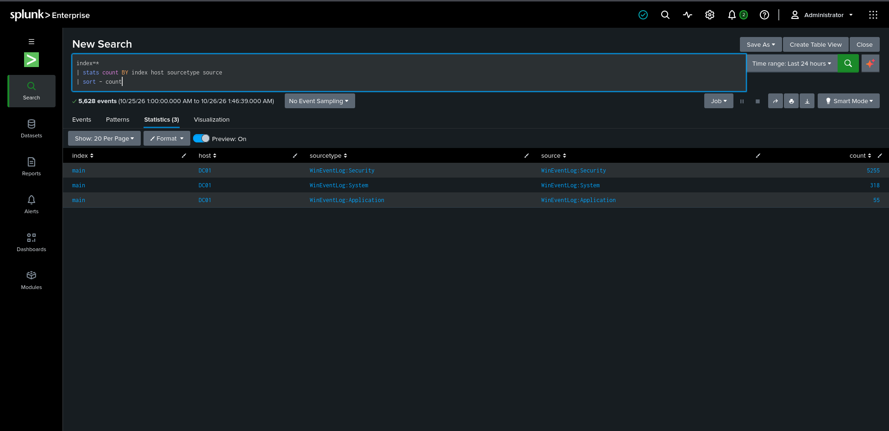


### Step 5 — Validate Windows Security event coverage

Check whether the following event IDs are present. Availability depends on audit policy, source role, collection configuration, permissions, and retention.

```spl
index=* (EventCode=4624 OR EventCode=4625 OR EventCode=4672 OR
                  EventCode=4728 OR EventCode=4732 OR EventCode=4769 OR
                  EventCode=4688)
| stats count min(_time) AS first_seen max(_time) AS last_seen
    BY host sourcetype EventCode
| convert ctime(first_seen) ctime(last_seen)
| sort host EventCode
```


- **4624** — successful logon
- **4625** — failed logon
- **4672** — special privileges assigned to a new logon
- **4728** — member added to a security-enabled global group
- **4732** — member added to a security-enabled local group
- **4769** — Kerberos service ticket requested
- **4688** — process creation, if the relevant audit policy is enabled

### Step 6 Validate Sysmon and PowerShell telemetry

On a Windows endpoint:

```powershell
Get-WinEvent -ListLog *Sysmon* |
    Select-Object LogName, IsEnabled, RecordCount

Get-WinEvent -ListLog *PowerShell* |
    Select-Object LogName, IsEnabled, RecordCount
```

To inspect recent local PowerShell events:

```powershell
Get-WinEvent -LogName 'Microsoft-Windows-PowerShell/Operational' -MaxEvents 20 |
    Select-Object TimeCreated, Id, ProviderName, Message
```


## Telemetry and data model

| Event/source | Security purpose | Useful fields to verify | Possible use |
|---|---|---|---|
| Security 4624 | Successful logon | Target account, logon type, workstation, source address, time | Baseline and post-failure success |
| Security 4625 | Failed logon | Account, logon type, source address, status/substatus | Repeated failures |
| Security 4672 | Special privileges assigned | Account, logon ID, privileges | Privileged-session context |
| Security 4728 | Global security group membership added | Actor, target member, group, time | Sensitive group changes |
| Security 4732 | Local security group membership added | Actor, target member, group, time | Local group changes |
| Security 4769 | Kerberos service ticket requested | Requesting account, service, client address, ticket attributes if present | Unusual ticket-request patterns |
| Security 4688 | Process creation | New process, creator, command line if configured, process ID | Suspicious execution |
| Sysmon 1 (optional) | Process creation | Image, command line, parent image, user, hashes if configured | Process ancestry |
| Sysmon 3 (optional) | Network connection | Process, destination, port, protocol | Process/network pivots |
| PowerShell 4104 (optional) | Script block logging | Script text, user, host, time | Script investigation |
| System 7045 / Security 4697 (where available) | Service installation | Service name, image path, context where available | Possible persistence |


## Detection engineering catalogue


### DET-001 Repeated failed logons

- **Objective:** Identify a high volume of failures associated with an account and source.
- **Hypothesis:** Password guessing, brute force, stale credentials, or an application misconfiguration.
- **Telemetry:** Security 4625.
- **Fields:** Account and source address, after verification.
- **ATT&CK:** T1110 — Brute Force, as a hypothesis only when context supports it.
- **Severity:** Medium by default; increase for privileged accounts, unusual sources, broad targeting, or a subsequent success.
- **Limitations / false positives:** Expired saved credentials, scheduled tasks, applications, user error, NAT, and shared source addresses can create clusters. A threshold is not proof of malicious activity.

```spl
index=* sourcetype="WinEventLog:Security" EventCode=4625
| bin _time span=5m
| stats count AS failures
    values(host) AS hosts
    values(Account_Domain) AS domains
    values(Logon_Type) AS logon_types
    values(Failure_Reason) AS failure_reasons
    BY _time Account_Name Source_Network_Address
| where failures >= 3
| sort - failures
```

**How it works:** Counts failures in five-minute buckets by account and source address. `TargetUserName` and `IpAddress` are example fields; confirm them. The threshold is illustrative and must be tuned.


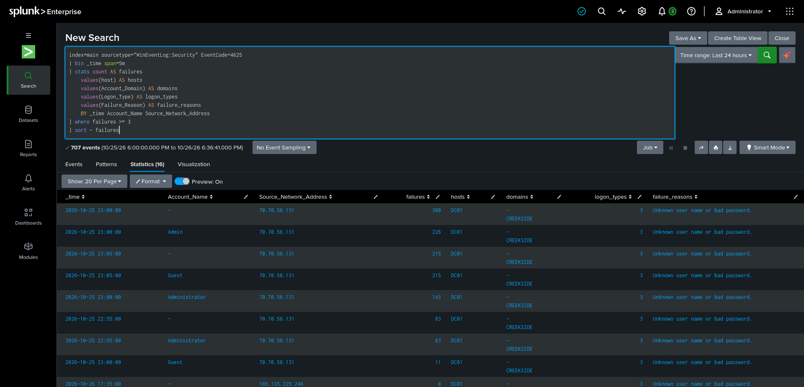


### DET-002 Failed logons followed by a successful logon

- **Objective:** Find an account/source combination with failures followed by success.
- **Hypothesis:** An account may eventually authenticate after guessing attempts; user mistakes and saved credentials can also cause this pattern.
- **Telemetry:** Security 4625 and 4624.
- **Fields:** Comparable normalized account and source values.
- **ATT&CK:** T1110 may apply if other evidence supports password guessing.
- **Severity:** Medium; raise for privileged accounts, unusual sources, or suspicious post-authentication activity.
- **Limitations / false positives:** Source fields may be blank or inconsistent. A simple previous-event method can miss a failure if another event intervenes.

```spl
index=main sourcetype="WinEventLog:Security" (EventCode=4625 OR EventCode=4624)
| eval event_kind=case(EventCode=4625,"failure", EventCode=4624,"success")
| eval account=coalesce(TargetUserName, Account_Name, user)
| eval src=coalesce(IpAddress, src_ip, Source_Network_Address)
| where isnotnull(account) AND isnotnull(src) AND src!="-"
| sort 0 account src _time
| streamstats current=f last(event_kind) AS previous_kind last(_time) AS previous_time BY account src
| where event_kind="success" AND previous_kind="failure" AND (_time-previous_time)<=900
| eval delay_seconds=_time-previous_time
| table _time host account src previous_time delay_seconds event_kind
| sort - _time
```

**How it works:** Normalizes candidate fields, orders events by account/source/time, and looks for a success whose immediately preceding event in that group was a failure within 15 minutes.

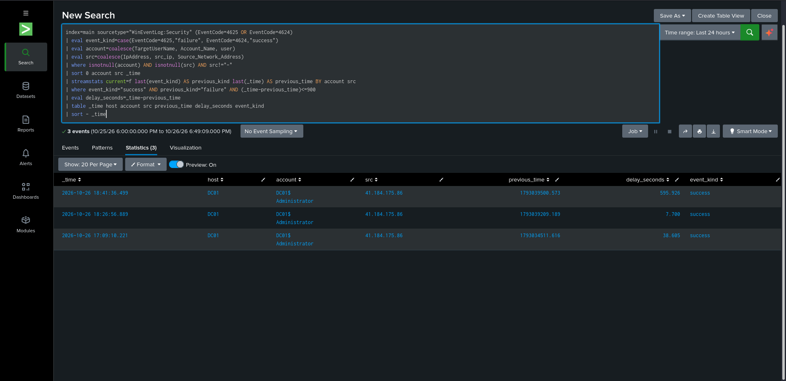

### DET-003 Suspicious PowerShell activity

- **Objective:** Surface script blocks or process events with patterns requiring review.
- **Hypothesis:** PowerShell can support legitimate administration or suspicious execution, discovery, and defense evasion.
- **Telemetry:** PowerShell 4104, Security 4688, and/or Sysmon 1, if collected.
- **Fields:** Script-block text or command line, account, host, process.
- **ATT&CK:** T1059.001 — PowerShell, when supported by the observed behavior.
- **Severity:** Context-dependent; a string match alone is not proof of compromise.
- **Limitations / false positives:** Administrative scripts may match; script blocks can be split or absent.

```spl
index=* (EventCode=4104 OR EventCode=4688 OR EventID=1)
| eval detail=lower(coalesce(ScriptBlockText, Message, CommandLine, Process_Command_Line, _raw))
| where match(detail, "(encodedcommand|frombase64string|downloadstring|invoke-expression|\\biex\\b)")
| table _time host user Account_Name EventCode EventID detail
| sort - _time
```

**How it works:** Searches available text for illustrative patterns. It may match benign activity and miss obfuscated or differently represented commands. Adapt fields and event IDs. Avoid publishing sensitive script content.


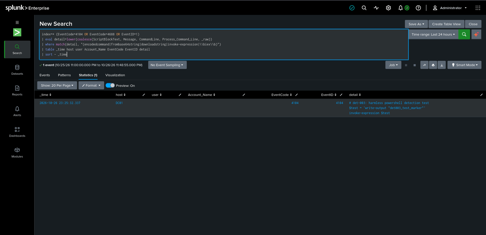
 

### DET-004 Sensitive group membership changes

- **Objective:** Identify additions to security groups for review.
- **Hypothesis:** An account may gain access through an unauthorized group change.
- **Telemetry:** Security 4728 and 4732.
- **Fields:** Actor, target member, group, host, timestamp.
- **ATT&CK:** T1098 — Account Manipulation may apply depending on the observed action.
- **Severity:** High if a privileged group is changed without an approved reason; otherwise contextual.
- **Limitations / false positives:** Approved administration and identity lifecycle workflows generate legitimate changes. Event fields vary by event type.

```spl
index=* (EventCode=4728 OR EventCode=4732)
| eval actor=coalesce(SubjectUserName, Subject_Account_Name)
| eval changed_group=coalesce(TargetUserName, Group_Name, GroupName)
| eval actor_domain=coalesce(SubjectDomainName, Subject_Domain_Name)
| eval member_domain=coalesce(MemberDomain, Member_Domain)
| table _time host EventCode actor changed_group _raw
| sort - _time
```

**How it works:** Lists candidate group additions and includes raw event content for validation.


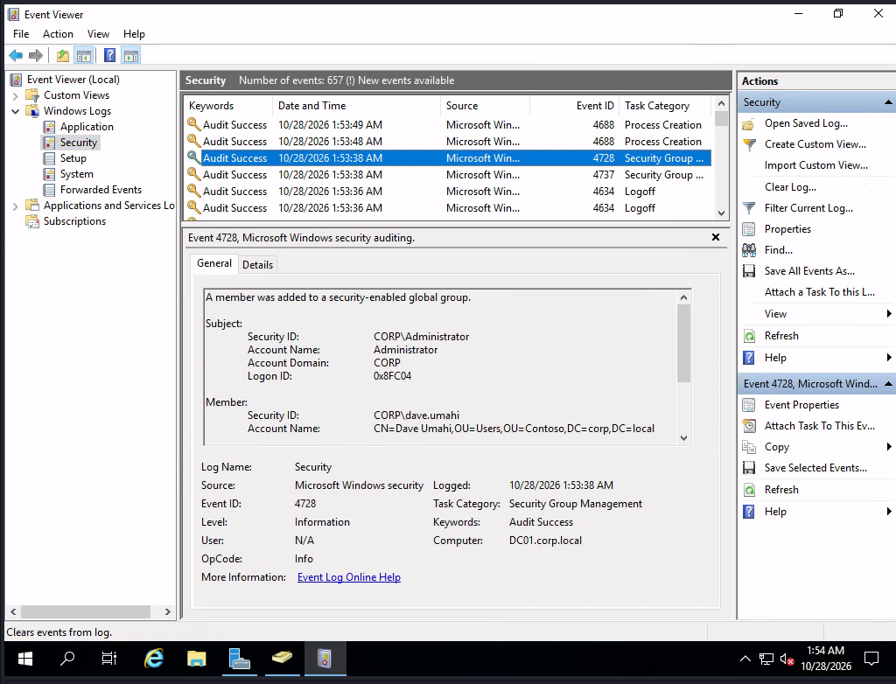
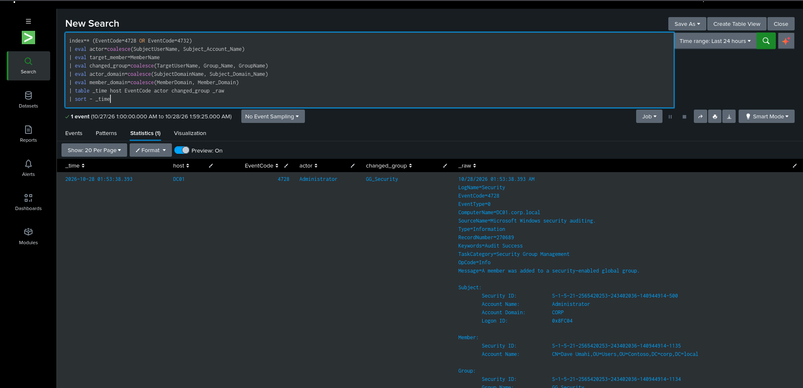


### DET-005 Unusual Kerberos service-ticket requests / potential Kerberoasting

- **Objective:** Identify unusual service-ticket request volume or diversity for investigation.
- **Hypothesis:** Unusual ticket-request patterns may be consistent with reconnaissance or Kerberoasting; Event 4769 alone is not proof.
- **Telemetry:** Security 4769.
- **Fields:** Requesting account, service name, client address, ticket/encryption attributes where available.
- **ATT&CK:** T1558.003 — Kerberoasting, only where supported by evidence.
- **Severity:** Medium initially; increase with unusual volume, sensitive service accounts, anomalous attributes, and corroborating events.
- **Limitations / false positives:** Applications, scheduled tasks, and normal service discovery can create many tickets; field availability varies.

```spl
iindex=* EventCode=4769
| stats count AS ticket_requests
        dc(Account_Name) AS unique_accounts
        dc(Service_Name) AS unique_services
        values(Account_Name) AS accounts
        values(Service_Name) AS services
        by host
| sort - ticket_requests
```

**How it works:** Groups requests into ten-minute windows and flags illustrative volume/diversity thresholds. 

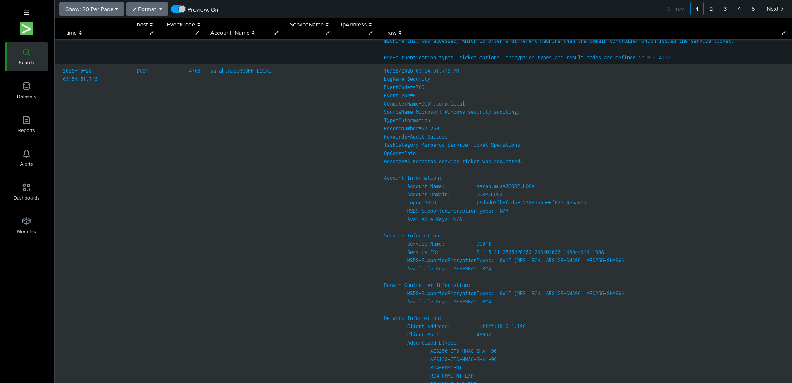
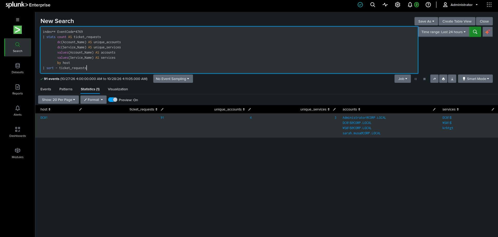


### DET-006 Suspicious remote logons and lateral movement

- **Objective:** Find remote logons for review and pivot into subsequent activity on destination hosts.
- **Hypothesis:** A compromised identity may authenticate to additional hosts or use remote services.
- **Telemetry:** Security 4624 with logon type and source fields; correlate with process/service events only if collected.
- **Fields:** Account, source address, host, logon type.
- **ATT&CK:** T1021 (Remote Services) may apply when a specific remote-service behavior is evidenced. Logon type alone does not establish a sub-technique.
- **Severity:** Medium for unusual remote access; higher for privileged accounts, unexpected hosts, or corroborating execution.
- **Limitations / false positives:** IT administration, jump hosts, service accounts, and management tools generate legitimate remote logons.

```spl
index=* EventCode=4624
| eval account=coalesce(TargetUserName, Account_Name, user)
| eval src=coalesce(IpAddress, Source_Network_Address, src_ip)
| eval logon_type=coalesce(LogonType, Logon_Type)
| eval logon_type=tostring(logon_type)
| where logon_type="3" OR logon_type="10"
| where isnotnull(account) AND account!="-"
| table _time host account src logon_type AuthenticationPackageName
| sort 0 - _time
```

**How it works:** Lists network (type 3) and remote interactive (type 10) logons when those values are present. 

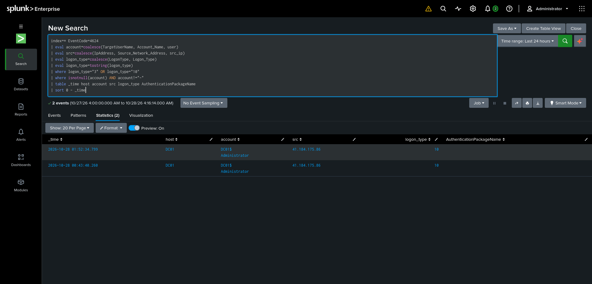


### DET-007 New service installation / possible persistence

- **Objective:** Find service installation events for review.
- **Hypothesis:** Services can be used for legitimate software installation or as persistence/execution mechanisms.
- **Telemetry:** System 7045 and/or Security 4697, if collected.
- **Fields:** Service name, image path, time, host, actor/context where available.
- **ATT&CK:** T1543.003 — Windows Service, when supported by the evidence.
- **Severity:** Medium by default; raise for unexpected binaries, suspicious paths, privileged context, or correlated activity.
- **Limitations / false positives:** Software installation, updates, and approved administration create services. Sources may capture different event types.

```spl
index=wineventlog (EventCode=7045 OR EventCode=4697 OR EventID=7045 OR EventID=4697)
| table _time host source sourcetype EventCode EventID _raw
| sort - _time
```

**How it works:** Retrieves candidate service-installation events and displays possible fields.

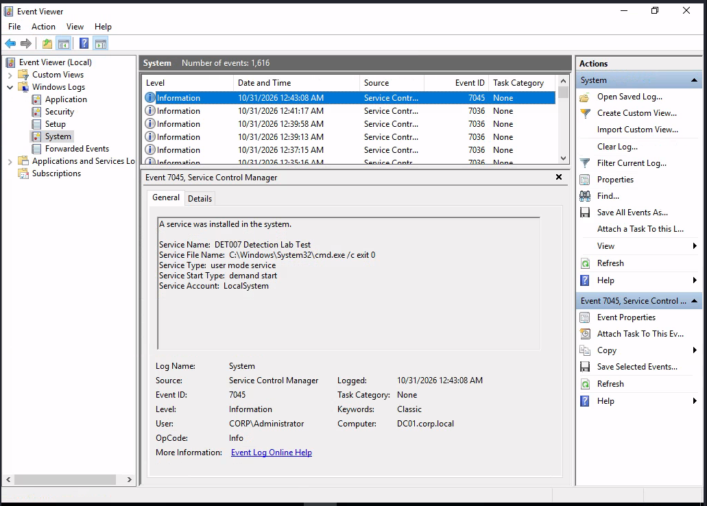
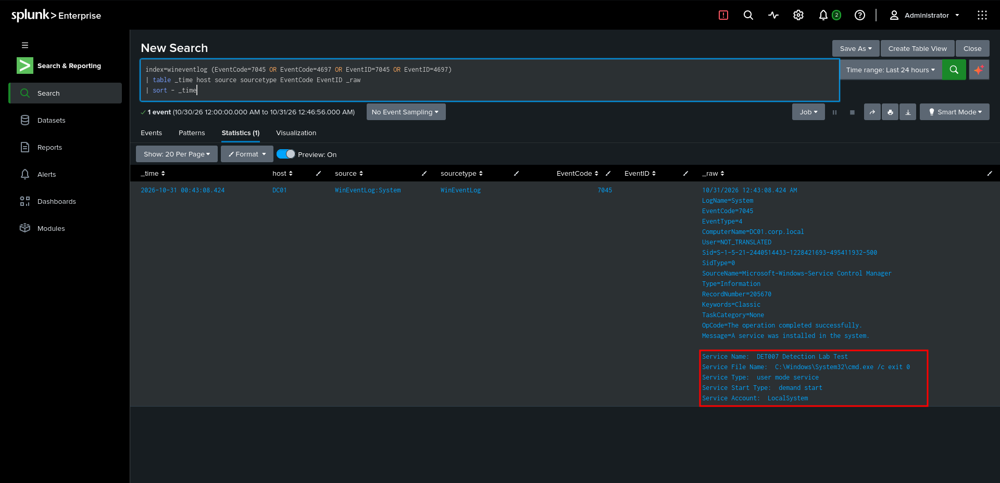
 

### DET-008 Suspicious process execution

- **Objective:** Find selected process names or command-line patterns for review.
- **Hypothesis:** Unusual process chains or utilities may be suspicious when combined with unexpected parents, accounts, or network activity.
- **Telemetry:** Security 4688 and/or Sysmon 1, if collected.
- **Fields:** Process image, command line, parent, account, host, time.
- **ATT&CK:** Map only after the behavior—not just the process name—supports a technique.
- **Severity:** Context-dependent; process names alone are weak signals.
- **Limitations / false positives:** Administrative tools and installers can match. Command-line collection may be disabled.

```spl
index=wineventlog (EventCode=4688 OR EventID=4688 OR EventCode=1 OR EventID=1)
| eval event_id=coalesce(EventCode, EventID)
| eval process_detail=lower(mvjoin(mvappend(
    Image,
    ProcessName,
    CommandLine,
    Process_Command_Line,
    ProcessCommandLine,
    ParentImage,
    _raw
), " "))
| where match(process_detail, "(psexec(\.exe)?|rundll32\.exe|regsvr32\.exe|wmic\.exe)")
| table _time host event_id Image CommandLine ParentImage process_detail
| sort - _time
```

**How it works:** Searches candidate fields for selected process names. The list is illustrative and neither exhaustive nor inherently malicious. 

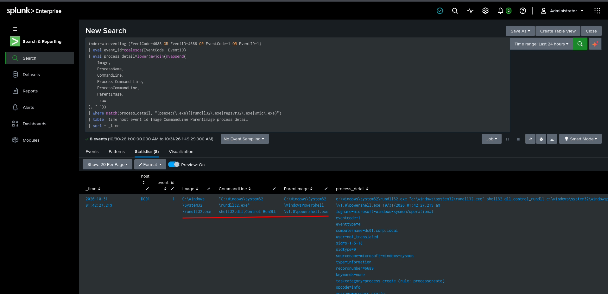


## Conclusion

This project is designed to demonstrate an evidence-led detection engineering lifecycle: verify telemetry, develop and explain SPL, validate with controlled lab activity, investigate results, and document limitations. 
